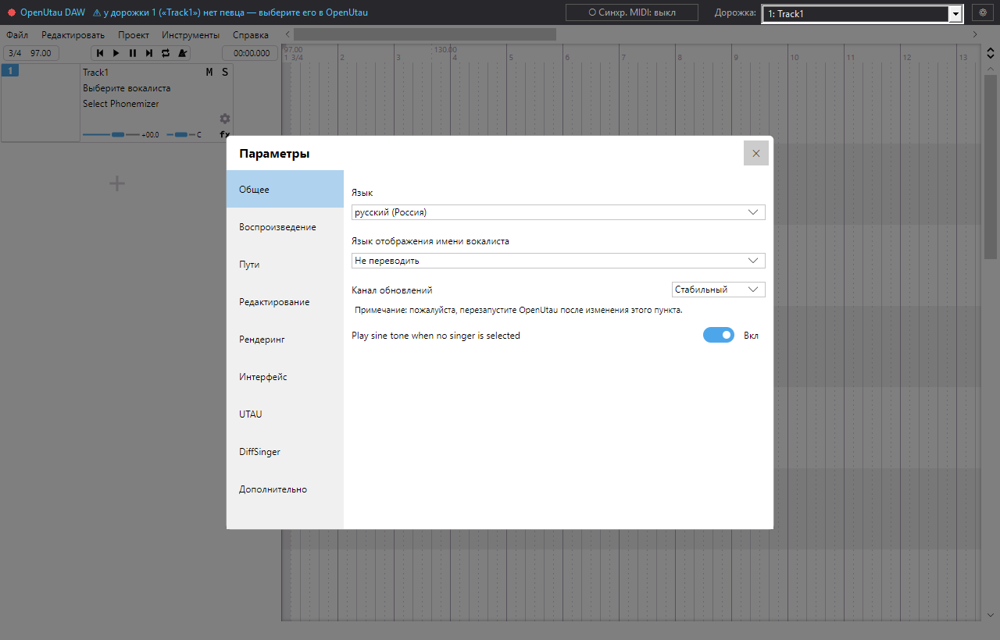
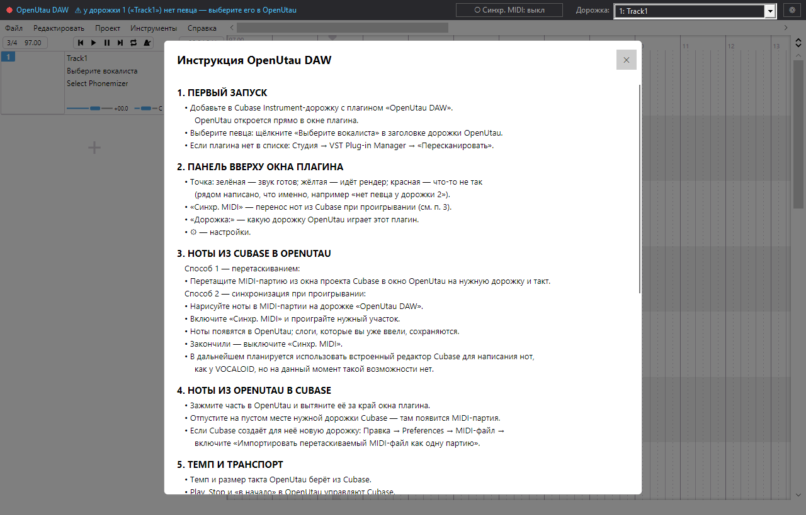

# OpenUtau DAW

**OpenUtau прямо внутри Cubase — как VOCALOID, только бесплатно**

[**⬇ Скачать установщик**](../../releases/latest) · [**📖 Инструкция**](docs/GUIDE.md) · [English](#english)

## Что это

OpenUtau DAW — плагин для Cubase, который открывает редактор пения [OpenUtau](https://github.com/stakira/OpenUtau) прямо в окне плагина. Вокал пишется и звучит внутри проекта Cubase, без экспорта WAV туда-обратно.

- 🎤 **OpenUtau в окне плагина.** Добавили Instrument-дорожку — и редактор уже там.
- ⏱ **Темп и размер из Cubase.** Для смены темпа по ходу песни есть ARA-мост **OpenUtau DAW Bridge**.
- ▶ **Общий транспорт.** Play, Stop и «в начало» в OpenUtau управляют Cubase.
- 🎹 **Ноты туда и обратно.** MIDI-партии перетаскиваются из Cubase в OpenUtau и обратно.
- 👥 **Несколько голосов.** Каждая дорожка «OpenUtau DAW» — свой голос.
- 💾 **Всё сохраняется с проектом Cubase.**
- 🌍 **14 языков.**

| | |
|---|---|
|  |  |
| Плагин на Instrument-дорожке | Окна OpenUtau открываются поверх плагина |
|  |  |
| Встроенная инструкция | Установщик с выбором языка |

## Установка

1. Скачайте `OpenUtauDAW-Setup-2.7.0.exe` (или zip-архив с ним) из раздела [**Releases**](../../releases/latest).
2. **Закройте Cubase** — иначе файл плагина будет занят.
3. Запустите установщик, выберите язык, примите лицензионное соглашение.
4. Откройте Cubase и добавьте Instrument-дорожку с плагином **OpenUtau DAW**.

Если плагина нет в списке: *Studio → VST Plug-in Manager → пересканировать*.
Новая версия ставится поверх старой; настройки OpenUtau, голосовые банки и проекты не трогаются.

**Требования:** Windows 10/11 64-bit, Cubase 15 (проверено). Плагин в форматах VST3 и CLAP; мост темпа — ARA2.

## Быстрый старт

1. Выберите певца в заголовке дорожки OpenUtau. Голосовые банки (.zip) просто перетащите в окно OpenUtau.
2. Пишите ноты и текст в OpenUtau — звук идёт через дорожку Cubase.
3. Перед экспортом дождитесь **зелёной точки** на панели плагина.

**[📖 Полная инструкция](docs/GUIDE.md)** — с картинками, на 14 языках. Она же ставится вместе с программой и открывается в OpenUtau: *Справка → «Инструкция OpenUtau DAW»*.

## Проверка файлов

Контрольные суммы SHA-256 — в файле `SHA256SUMS.txt` у каждого релиза.

## Лицензия и благодарности

OpenUtau DAW бесплатен. Условия — в лицензионном соглашении, которое показывает установщик (и `LICENSE.txt` в папке программы).

Проект построен на чужой отличной работе:

- [OpenUtau](https://github.com/stakira/OpenUtau) — stakira и участники (MIT)
- [openutau-vst-bridge](https://github.com/KakaruHayate/openutau-vst-bridge) — KakaruHayate и участники (MPL-2.0), основа плагина
- VST 3 SDK — Steinberg (MIT), [CLAP](https://github.com/free-audio/clap) и [clap-wrapper](https://github.com/free-audio/clap-wrapper) (MIT), ARA SDK — Celemony (Apache 2.0)

Исходный код частей под MPL-2.0 устанавливается вместе с программой в папку `source`. Полные тексты лицензий — в `THIRD-PARTY-NOTICES.txt`.

OpenUtau DAW не связан со Steinberg, Yamaha, Celemony или авторами OpenUtau. Cubase и VST — товарные знаки Steinberg Media Technologies GmbH, ARA — Celemony Software GmbH. Голосовые банки распространяются их авторами на их условиях.

---

## English

**OpenUtau DAW** puts the [OpenUtau](https://github.com/stakira/OpenUtau) singing editor right inside a Cubase plug-in window.

- 🎤 **OpenUtau in the plug-in window.** Add an Instrument track — the editor is already there.
- ⏱ **Tempo and time signature from Cubase.** For tempo changes there is the **OpenUtau DAW Bridge** ARA extension.
- ▶ **Shared transport.** Play, Stop and Home in OpenUtau control Cubase.
- 🎹 **Notes both ways.** Drag MIDI parts from Cubase to OpenUtau and back.
- 👥 **Several voices.** Each "OpenUtau DAW" track is its own voice.
- 💾 **Saved with the Cubase project.**
- 🌍 **14 languages.**

**Install:** download the installer from [Releases](../../releases/latest), close Cubase, run it, then add an Instrument track with **OpenUtau DAW**. Requires Windows 10/11 x64; tested with Cubase 15. **[📖 Full guide](docs/GUIDE-en.md)**.

Built on OpenUtau (MIT), openutau-vst-bridge (MPL-2.0), the VST 3 SDK, CLAP, clap-wrapper and the ARA SDK — see the license page of the installer and `THIRD-PARTY-NOTICES.txt`. Not affiliated with Steinberg, Yamaha, Celemony or the OpenUtau authors.

.Борислав(BoBeR 76)

