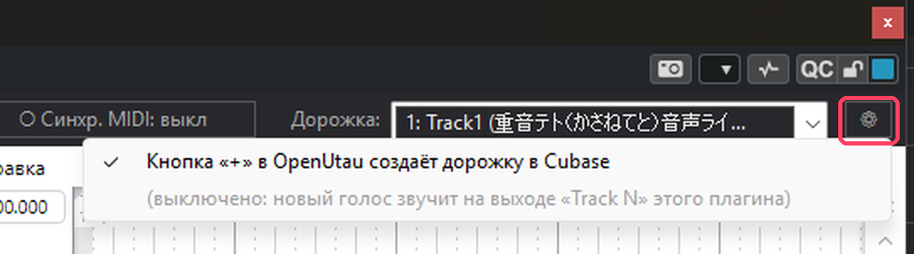

# 📖 Návod k OpenUtau DAW

[← Domů](../README.md)

🌍 [Русский](GUIDE.md) · [English](GUIDE-en.md) · [Українська](GUIDE-uk.md) · [日本語](GUIDE-ja.md) · [Español](GUIDE-es.md) · [Deutsch](GUIDE-de.md) · [Français](GUIDE-fr.md) · [Italiano](GUIDE-it.md) · [Português](GUIDE-pt.md) · [Polski](GUIDE-pl.md) · **Čeština** · [Türkçe](GUIDE-tr.md) · [简体中文](GUIDE-zh.md) · [한국어](GUIDE-ko.md)

> [!NOTE]
> Tento návod byl přeložen strojovým překladačem: autor neumí česky. Opravy jsou vítány v [Issues](https://github.com/BoBeR76/OpenUtau-DAW/issues).

OpenUtau DAW vkládá editor zpěvu OpenUtau přímo do okna pluginu v Cubase. Zde je popsáno, co plugin přidává; samotný OpenUtau funguje jako obvykle. *(Animace ukazují ruské rozhraní. Nabídky OpenUtau nejsou do češtiny přeloženy, proto jsou uvedeny anglicky.)*

## Instalace

1. Stáhněte `OpenUtauDAW-Setup-2.7.0.exe` z [Releases](https://github.com/BoBeR76/OpenUtau-DAW/releases/latest).
2. **Zavřete Cubase.** Pokud běží, instalátor vás požádá o jeho zavření a kliknutí na „Zkusit znovu“.
3. Na první stránce zvolte jazyk — bude to i jazyk OpenUtau a lišty pluginu.
4. Zaškrtněte políčko licenční smlouvy — bez něj nelze kliknout na „Další“.

Nainstaluje se plugin **OpenUtau DAW** (VST3 a CLAP), most tempa **OpenUtau DAW Bridge** (ARA2) a OpenUtau pro DAW do `C:\OpenUtau-DAW`.

| | |
|---|---|
|  |  |

> **Aktualizace.** Nová verze se instaluje přes starou. Nastavení OpenUtau, hlasové banky a projekty zůstanou zachovány.

## První spuštění

1. V Cubase přidejte **stopu nástroje** s pluginem **OpenUtau DAW**.
2. **OpenUtau se otevře přímo v okně pluginu** a už v něm bude prázdná stopa pro tento plugin.
3. Vyberte zpěváka a můžete psát.

> Pokud plugin v seznamu není: *Studio → VST Plug-in Manager → znovu prohledat*.

## Lišta pluginu

Pruh nad OpenUtau v okně pluginu:

| Co vidíte | Co to znamená |
|---|---|
| 🟢 **připojeno** | Vše připraveno, zvuk odpovídá notám |
| 🟡 **renderování 45 %** | OpenUtau připravuje zvuk |
| 🔴 **⚠ …** | Něco je špatně — a je napsáno co, např. „stopa 1 nemá zpěváka — vyberte ho v OpenUtau“ |
| **110.00 BPM** | Tempo Cubase, které vidí OpenUtau |
| **Synch. MIDI** | Přebírá noty z Cubase při přehrávání (viz níže) |
| **⚙** | Nastavení pluginu |

## Noty mezi Cubase a OpenUtau

### Přetažením

- **Cubase → OpenUtau:** přetáhněte MIDI part z okna projektu Cubase do okna OpenUtau, na požadovanou stopu a takt.
- **OpenUtau → Cubase:** podržte part v OpenUtau, přetáhněte ho **za okraj okna pluginu** a pusťte na **prázdné místo** stopy v Cubase.

> Pokud Cubase dá part na novou stopu: *Edit → Preferences → MIDI → MIDI File* → zapněte **„Import Dropped File as Single Part“**.

### Synchronizace při přehrávání

1. Napište noty do MIDI partu na stopě „OpenUtau DAW“.
2. Zapněte **„Synch. MIDI“** na liště pluginu a přehrajte úsek.
3. Noty se objeví v OpenUtau. **Už zadané slabiky zůstanou** — melodii můžete upravit v Cubase, aniž byste přišli o text.
4. Na konci „Synch. MIDI“ vypněte.

### Klávesy se rozsvěcují

Stisknuté noty jsou vidět v piano rollu OpenUtau — jako v editoru Cubase:

- hrajete na **MIDI klávesnici** nebo klikáte na klávesy v editoru Cubase — tyto klávesy **se rozsvítí v OpenUtau**;
- klikáte na klávesy piano rollu OpenUtau — nota zazní **přes Cubase**, na výstupu pluginu.

## Transport a tempo

- **Přehrát, Stop a „na začátek“** v OpenUtau (a `Mezerník`, `Home`) ovládají Cubase — hraje celá píseň, ne jen zpěv.
- **Tempo a takt** přebírá OpenUtau z Cubase: změníte BPM — OpenUtau se přizpůsobí.

## Most tempa OpenUtau DAW Bridge

Pokud se **tempo během písně mění**, přidejte most — OpenUtau pak zná celou mapu tempa a taktů. Jednou na projekt:

1. Vytvořte zvukovou stopu a dejte na ni libovolnou zvukovou událost přes celou délku písně. Ztlumte ji (Mute).
2. Vyberte událost → *Audio → Extensions →* **„OpenUtau DAW Bridge“**.

Most funguje stejně jako u VOCALOIDu.

## Více hlasů

**Každá stopa „OpenUtau DAW“ v Cubase je samostatný hlas**, všechny v jednom okně OpenUtau.

- Nová stopa „OpenUtau DAW“ v Cubase → nová prázdná stopa v OpenUtau.
- **„+“** v OpenUtau → nová stopa **i v Cubase**.

- **Název a barva** stopy Cubase se přenesou do OpenUtau.

### ⚙ Pokud „+“ nemá vytvářet stopu v Cubase

> [!TIP]
> **Potřebujete více hlasů na jedné stopě Cubase?** Klikněte na **⚙** vpravo na liště pluginu a zrušte zaškrtnutí **„Tlačítko „+“ v OpenUtau přidá stopu i v Cubase“**.
>
> Pak „+“ přidá hlas jen v OpenUtau a ten zní na samostatném výstupu **„Track N“** téhož pluginu (zapněte ho v **F11**).

## Ukládání a zálohy

- **Zpěv se ukládá automaticky spolu s projektem Cubase.**
- Uchovává se **posledních 10 verzí**. Obnovení: *File →* **„Obnovit ze zálohy“**.

## Drobné vymoženosti

- 🔁 **Automatický restart.** Když OpenUtau spadne, plugin ho znovu spustí. Zpěv se neztratí.
- 🪟 **Okna nad pluginem.** Nastavení, zpěváci a zprávy OpenUtau se otevírají nad oknem pluginu — Cubase ho neskryje.
- 🎚 **Samostatné výstupy.** 8 stereo výstupů „Track 1…8“, jeden na každou stopu OpenUtau (zapínají se v F11).
- ⏳ **Export čeká na render.** Pokud OpenUtau ještě připravuje zvuk, Audio Mixdown počká.
- ⚡ **Žádná zbytečná okna.** V Cubase OpenUtau přeskočí úvodní stránku a hned otevře zpěv projektu.
- 🌍 **14 jazyků** a lišta pluginu mluví stejným jazykem jako OpenUtau.

## Co zatím nejde

- **Psát noty ve vestavěném editoru Cubase** (jako u VOCALOIDu) a živá obousměrná synchronizace not. Čeká se na ARA 3 — jakmile ho Celemony vydá, bude to hotové.
- Značky Cubase nejsou pluginům dostupné, proto je OpenUtau nezobrazuje.

## Časté otázky

**Instalátor hlásí, že Cubase běží.** Zavřete Cubase úplně (proces běží ještě pár sekund po zavření okna) a klikněte na „Zkusit znovu“.

**Žádný zvuk.** Podívejte se na tečku na liště pluginu: 🔴 — vedle je napsán důvod; 🟡 — počkejte na konec renderování.

**Plugin není v seznamu.** *Studio → VST Plug-in Manager → znovu prohledat*.

**„OpenUtau je otevřen v jiném okně pluginu“.** Klikněte na zprávu — OpenUtau se přesune do tohoto okna.
