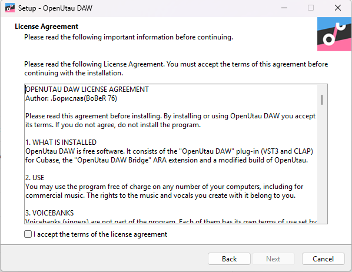
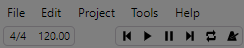
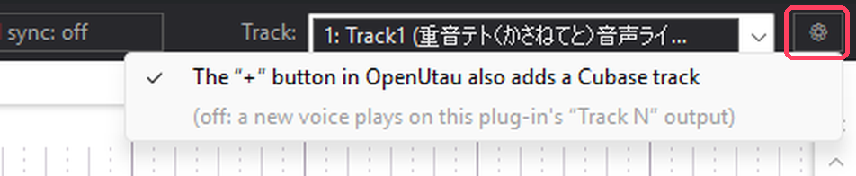

# 📖 OpenUtau DAW – Anleitung

[← Startseite](README.de.md)

🌍 [Русский](GUIDE.md) · [English](GUIDE-en.md) · [Українська](GUIDE-uk.md) · [日本語](GUIDE-ja.md) · [Español](GUIDE-es.md) · **Deutsch** · [Français](GUIDE-fr.md) · [Italiano](GUIDE-it.md) · [Português](GUIDE-pt.md) · [Polski](GUIDE-pl.md) · [Čeština](GUIDE-cs.md) · [Türkçe](GUIDE-tr.md) · [简体中文](GUIDE-zh.md) · [한국어](GUIDE-ko.md)

> [!NOTE]
> Diese Anleitung wurde maschinell übersetzt: Der Autor spricht kein Deutsch. Korrekturen sind in den [Issues](https://github.com/BoBeR76/OpenUtau-DAW/issues) willkommen.

OpenUtau DAW bettet den Gesangseditor OpenUtau direkt in das Plug-in-Fenster von Cubase ein. Hier steht, was das Plug-in hinzufügt; OpenUtau selbst funktioniert wie gewohnt. *(Die Animationen zeigen die russische Oberfläche.)*

## Installation

1. Laden Sie `OpenUtauDAW-Setup-2.7.1.exe` unter [Releases](https://github.com/BoBeR76/OpenUtau-DAW/releases/latest) herunter.
2. **Schließen Sie Cubase.** Läuft Cubase noch, bittet das Setup darum, es zu schließen und auf „Wiederholen“ zu klicken.
3. Wählen Sie auf der ersten Seite die Sprache – sie wird auch die Sprache von OpenUtau und der Plug-in-Leiste.
4. Setzen Sie das Häkchen beim Lizenzvertrag – vorher lässt sich „Weiter“ nicht anklicken.

Installiert werden das Plug-in **OpenUtau DAW** (VST3 und CLAP), die Tempo-Brücke **OpenUtau DAW Bridge** (ARA2) und OpenUtau für DAW in `C:\OpenUtau-DAW`.

| | |
|---|---|
|  |  |

> **Update.** Eine neue Version wird über die alte installiert. OpenUtau-Einstellungen, Stimmbanken und Projekte bleiben erhalten.

## Erster Start

1. Fügen Sie in Cubase eine **Instrumentenspur** mit dem Plug-in **OpenUtau DAW** hinzu.
2. **OpenUtau öffnet sich direkt im Plug-in-Fenster**, und darin wird automatisch eine leere Spur für dieses Plug-in angelegt.
3. Sänger wählen – und loslegen.

> Wenn das Plug-in nicht in der Liste steht: *Studio → VST Plug-in Manager → neu scannen*.

## Die Plug-in-Leiste

Die Leiste über OpenUtau im Plug-in-Fenster:

| Anzeige | Bedeutung |
|---|---|
| 🟢 **verbunden** | Alles bereit, der Klang entspricht den Noten |
| 🟡 **Rendern 45 %** | OpenUtau bereitet den Klang vor |
| 🔴 **⚠ …** | Etwas stimmt nicht – und es steht da, was, z. B. „Spur 1 hat keinen Sänger – wählen Sie ihn in OpenUtau“ |
| **110.00 BPM** | Das Cubase-Tempo, das OpenUtau sieht |
| **MIDI-Sync** | Übernimmt beim Abspielen Noten aus Cubase (siehe unten) |
| **⚙** | Plug-in-Einstellungen |

## Noten zwischen Cubase und OpenUtau

### Ziehen und Ablegen

- **Cubase → OpenUtau:** Ziehen Sie einen MIDI-Part aus dem Cubase-Projektfenster in das OpenUtau-Fenster – auf die gewünschte Spur und den Takt.
- **OpenUtau → Cubase:** Halten Sie einen Part in OpenUtau fest, ziehen Sie ihn **über den Rand des Plug-in-Fensters** hinaus und legen Sie ihn an einer **leeren Stelle** einer Cubase-Spur ab.

> Wenn Cubase den Part auf eine neue Spur legt: *Bearbeiten → Programmeinstellungen → MIDI → MIDI-Datei* → **„Abgelegte Datei als einzelnen Part importieren“** einschalten.

### Synchronisieren beim Abspielen

1. Schreiben Sie Noten in einen MIDI-Part auf der Spur „OpenUtau DAW“.
2. Schalten Sie **„MIDI-Sync“** in der Plug-in-Leiste ein und spielen Sie den Abschnitt ab.
3. Die Noten erscheinen in OpenUtau. **Bereits eingegebene Silben bleiben erhalten** – die Melodie lässt sich in Cubase ändern, ohne den Text zu verlieren.
4. Danach „MIDI-Sync“ wieder ausschalten.

### Tasten leuchten auf

Gehaltene Noten sind in der Pianorolle von OpenUtau zu sehen – wie im Cubase-Editor:

- Sie spielen auf einem **MIDI-Keyboard** oder klicken auf die Tasten im Cubase-Editor – diese Tasten **leuchten in OpenUtau auf**;
- Sie klicken auf die Tasten der OpenUtau-Pianorolle – die Note erklingt **über Cubase**, am Ausgang des Plug-ins.

## Transport und Tempo

- **Abspielen, Stopp und „zum Anfang“** in OpenUtau (sowie `Leertaste`, `Pos1`) steuern Cubase – es spielt das ganze Lied, nicht nur der Gesang.
- **Tempo und Taktart** übernimmt OpenUtau aus Cubase: BPM geändert – OpenUtau folgt.

## Tempo-Brücke OpenUtau DAW Bridge

Wenn sich das **Tempo im Lied ändert**, fügen Sie die Brücke hinzu – dann kennt OpenUtau die ganze Tempo- und Taktkarte. Einmal pro Projekt:

1. Legen Sie eine Audiospur an und setzen Sie ein beliebiges Audio-Event darauf, das das ganze Lied abdeckt. Schalten Sie es stumm (Mute).
2. Event auswählen → *Audio → Erweiterungen →* **„OpenUtau DAW Bridge“**.

Die Brücke funktioniert genauso wie bei VOCALOID.

## Mehrere Stimmen

**Jede „OpenUtau DAW“-Spur in Cubase ist eine eigene Stimme**, alle in einem OpenUtau-Fenster.

- Neue „OpenUtau DAW“-Spur in Cubase → neue leere Spur in OpenUtau.
- **„+“** in OpenUtau → neue Spur **auch in Cubase**.

- **Name und Farbe** der Cubase-Spur werden in OpenUtau übernommen.

### ⚙ Wenn „+“ keine Cubase-Spur anlegen soll

> [!TIP]
> **Mehrere Stimmen auf einer Cubase-Spur?** Klicken Sie rechts in der Plug-in-Leiste auf **⚙** und entfernen Sie das Häkchen bei **„Die Schaltfläche „+“ in OpenUtau legt auch eine Cubase-Spur an“**.
>
> Dann fügt „+“ die Stimme nur in OpenUtau hinzu, und sie erklingt am eigenen Ausgang **„Track N“** dieses Plug-ins (in **F11** aktivieren).

## Speichern und Sicherungen

- **Der Gesang wird automatisch mit dem Cubase-Projekt gespeichert.**
- Die **letzten 10 Versionen** werden aufbewahrt. Wiederherstellen: *Datei →* **„Aus Sicherung wiederherstellen“**.

## Kleine Annehmlichkeiten

- 🔁 **Automatischer Neustart.** Stürzt OpenUtau ab, startet das Plug-in es neu. Der Gesang geht nicht verloren.
- 🪟 **Dialoge über dem Plug-in.** Einstellungen, Sänger und Meldungen von OpenUtau öffnen sich über dem Plug-in-Fenster – Cubase blendet es nicht aus.
- 🎚 **Separate Ausgänge.** 8 Stereoausgänge „Track 1…8“, je einer pro OpenUtau-Spur (in F11 aktivieren).
- ⏳ **Export wartet aufs Rendern.** Rendert OpenUtau noch, wartet der Audio-Mixdown.
- ⚡ **Keine überflüssigen Fenster.** In Cubase überspringt OpenUtau die Startseite und öffnet direkt den Gesang des Projekts.
- 🌍 **14 Sprachen**, und die Plug-in-Leiste spricht dieselbe Sprache wie OpenUtau.

## Noch nicht möglich

- **Noten im Cubase-eigenen Editor schreiben** (wie bei VOCALOID) und Live-Synchronisierung in beide Richtungen. Das wartet auf ARA 3 – sobald Celemony es veröffentlicht, wird es umgesetzt.
- Cubase-Marker sind für Plug-ins nicht zugänglich, daher zeigt OpenUtau sie nicht an.

## Häufige Fragen

**Das Setup meldet, dass Cubase läuft.** Schließen Sie Cubase vollständig (der Prozess läuft noch einige Sekunden nach dem Fenster) und klicken Sie auf „Wiederholen“.

**Kein Ton.** Sehen Sie auf den Punkt in der Plug-in-Leiste: 🔴 – daneben steht der Grund; 🟡 – warten Sie, bis das Rendern fertig ist.

**Das Plug-in steht nicht in der Liste.** *Studio → VST Plug-in Manager → neu scannen*.

**„OpenUtau ist in einem anderen Plug-in-Fenster geöffnet“.** Klicken Sie auf die Meldung – OpenUtau zieht in dieses Fenster um.
