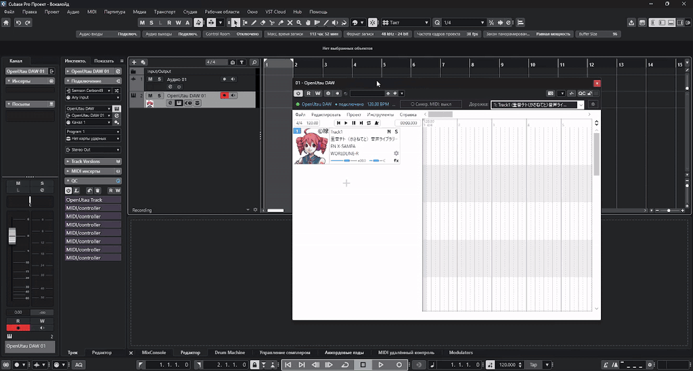

# 📖 OpenUtau DAW guide

[← Home](../README.md)

🌍 [Русский](GUIDE.md) · **English** · [Українська](GUIDE-uk.md) · [日本語](GUIDE-ja.md) · [Español](GUIDE-es.md) · [Deutsch](GUIDE-de.md) · [Français](GUIDE-fr.md) · [Italiano](GUIDE-it.md) · [Português](GUIDE-pt.md) · [Polski](GUIDE-pl.md) · [Čeština](GUIDE-cs.md) · [Türkçe](GUIDE-tr.md) · [简体中文](GUIDE-zh.md) · [한국어](GUIDE-ko.md)

> [!NOTE]
> This guide was translated with a machine translator: the author is a Russian speaker. If something reads oddly, corrections are welcome in [Issues](https://github.com/BoBeR76/OpenUtau-DAW/issues).

OpenUtau DAW puts the OpenUtau singing editor right inside a Cubase plug-in window. This guide covers what the plug-in adds; OpenUtau itself works as usual. *(The animations show the Russian UI.)*

## Contents

- [Installation](#installation)
- [First start](#first-start)
- [The plug-in bar](#the-plug-in-bar)
- [Notes between Cubase and OpenUtau](#notes-between-cubase-and-openutau)
- [Transport and tempo](#transport-and-tempo)
- [OpenUtau DAW Bridge (tempo map)](#openutau-daw-bridge-tempo-map)
- [Several voices](#several-voices)
- [Saving and backups](#saving-and-backups)
- [Nice little things](#nice-little-things)
- [Not possible yet](#not-possible-yet)
- [FAQ](#faq)

---

## Installation

1. Download `OpenUtauDAW-Setup-2.7.0.exe` from [Releases](https://github.com/BoBeR76/OpenUtau-DAW/releases/latest).
2. **Close Cubase.** If it is running, the installer asks you to close it and press "Retry".
3. Choose the language on the first page — it becomes the language of OpenUtau and the plug-in bar.
4. Tick the license agreement box — "Next" stays disabled until you do.

Installed: the **OpenUtau DAW** plug-in (VST3 and CLAP), the **OpenUtau DAW Bridge** tempo extension (ARA2) and OpenUtau for DAW in `C:\OpenUtau-DAW`.

| | |
|---|---|
|  |  |

> **Updating.** A new version installs over the old one. OpenUtau settings, voicebanks and projects are kept.

## First start

1. In Cubase, add an **Instrument track** with the **OpenUtau DAW** plug-in.
2. **OpenUtau opens right inside the plug-in window**, with an empty track already created for this plug-in.
3. Choose a singer and start writing.

> If the plug-in is not in the list: *Studio → VST Plug-in Manager → rescan*.

## The plug-in bar

The strip above OpenUtau in the plug-in window:

| What you see | Meaning |
|---|---|
| 🟢 **connected** | Ready, the sound matches the notes |
| 🟡 **rendering 45 %** | OpenUtau is preparing the sound |
| 🔴 **⚠ …** | Something is wrong — and it says what, e.g. "track 1 has no singer — choose one in OpenUtau" |
| **110.00 BPM** | The Cubase tempo OpenUtau sees |
| **MIDI sync** | Takes notes from Cubase while playing ([below](#sync-while-playing)) |
| **⚙** | Plug-in settings |

## Notes between Cubase and OpenUtau

### Drag and drop

- **Cubase → OpenUtau:** drag a MIDI part from the Cubase project window into the OpenUtau window, onto the track and bar you want.
- **OpenUtau → Cubase:** hold a part in OpenUtau, drag it **out over the edge of the plug-in window** and drop it on an **empty spot** of a Cubase track.

> If Cubase puts the part on a new track: *Edit → Preferences → MIDI → MIDI File* → turn on **"Import Dropped File as Single Part"**.

### Sync while playing

1. Write notes in a MIDI part on the "OpenUtau DAW" track.
2. Turn on **MIDI sync** in the plug-in bar and play the section.
3. The notes appear in OpenUtau. **Lyrics you already entered are kept** — you can edit the melody in Cubase without losing the text.
4. When done, turn MIDI sync off.

### Keys light up

Held notes show in the OpenUtau piano roll, just like in Cubase's editor:

- play a **MIDI keyboard** or click the keys in Cubase's editor — those keys **light up in OpenUtau**;
- click the keys of OpenUtau's piano roll — the note sounds **through Cubase**, on the plug-in's output.

## Transport and tempo

- **Play, Stop and "go to start"** in OpenUtau (and `Space`, `Home`) control Cubase — the whole song plays, not just the vocal.
- OpenUtau takes **tempo and time signature** from Cubase: change the BPM and OpenUtau follows.

## OpenUtau DAW Bridge (tempo map)

If the **tempo changes during the song**, add the bridge so OpenUtau knows the whole tempo and bar map. Once per project:

1. Create an audio track and put any audio event on it covering the whole song. Mute it.
2. Select the event → *Audio → Extensions →* **"OpenUtau DAW Bridge"**.

It works the same way as with VOCALOID.

## Several voices

**Each "OpenUtau DAW" track in Cubase is its own voice**, all in one OpenUtau window.

- A new "OpenUtau DAW" track in Cubase → a new empty track in OpenUtau.
- **"+"** in OpenUtau → a new track **in Cubase** too.

- The **name and colour** of the Cubase track carry over to OpenUtau.

### ⚙ If "+" should not create a Cubase track

> [!TIP]
> **Want several voices on one Cubase track?** Click **⚙** at the right end of the plug-in bar and untick **"The “+” button in OpenUtau also adds a Cubase track"**.
>
> Then "+" adds the voice only in OpenUtau, and it plays on the plug-in's own **"Track N"** output (enable it in **F11**). Handy if you don't want extra tracks in the project or mix voices through the outputs.

## Saving and backups

- **The vocal is saved with the Cubase project automatically.**
- The **last 10 versions** are kept. Restore one: *File →* **"Restore from Backup"**.

## Nice little things

- 🔁 **Auto-restart.** If OpenUtau crashes, the plug-in restarts it. The vocal is not lost.
- 🪟 **Dialogs over the plug-in.** Preferences, singers and messages open over the plug-in window — Cubase doesn't hide it.
- 🎚 **Separate outputs.** 8 stereo outputs "Track 1…8", one per OpenUtau track (enable them in F11).
- ⏳ **Export waits for rendering.** If OpenUtau is still rendering, Audio Mixdown waits.
- ⚡ **No extra windows.** Inside Cubase OpenUtau skips its start page and opens the project's vocal directly.
- 🌍 **14 languages**, and the plug-in bar speaks the same language as OpenUtau.

## Not possible yet

- **Writing notes in Cubase's own editor** (like VOCALOID) and live two-way note sync. This waits for ARA 3 — it will be done once Celemony releases it.
- Cubase markers are not available to plug-ins, so OpenUtau can't show them.

## FAQ

**The installer says Cubase is running.** Close Cubase completely (the process lingers a few seconds after the window) and press "Retry".

**No sound.** Check the dot in the plug-in bar: 🔴 — the reason is written next to it; 🟡 — wait for rendering to finish.

**The plug-in is not in the list.** *Studio → VST Plug-in Manager → rescan*.

**"OpenUtau is open in another plug-in window".** Click the message — OpenUtau moves to this window.
