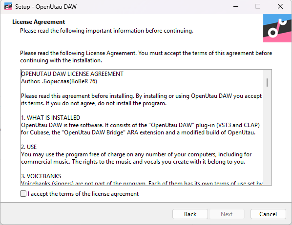
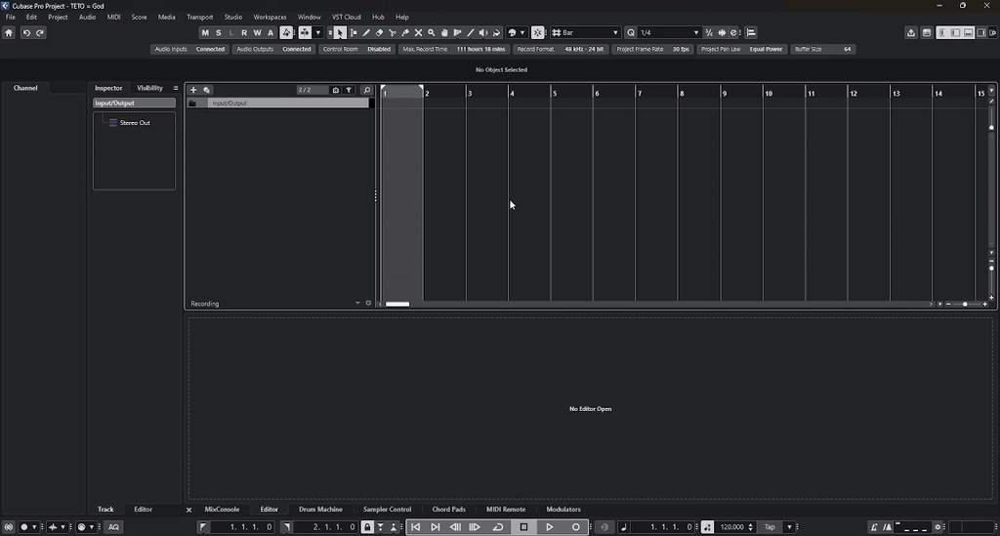
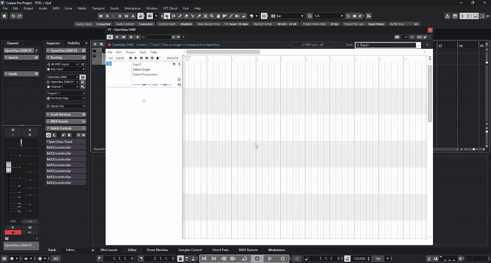
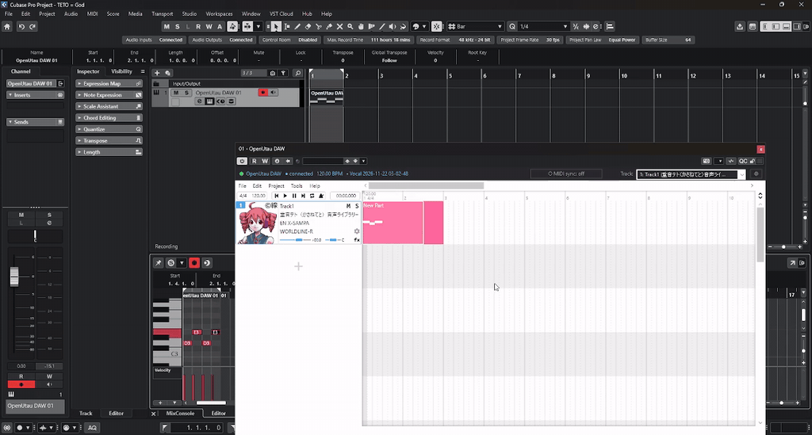
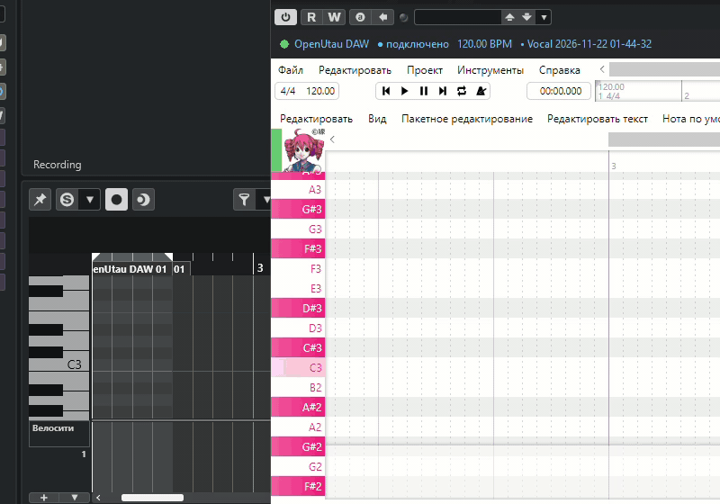
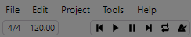
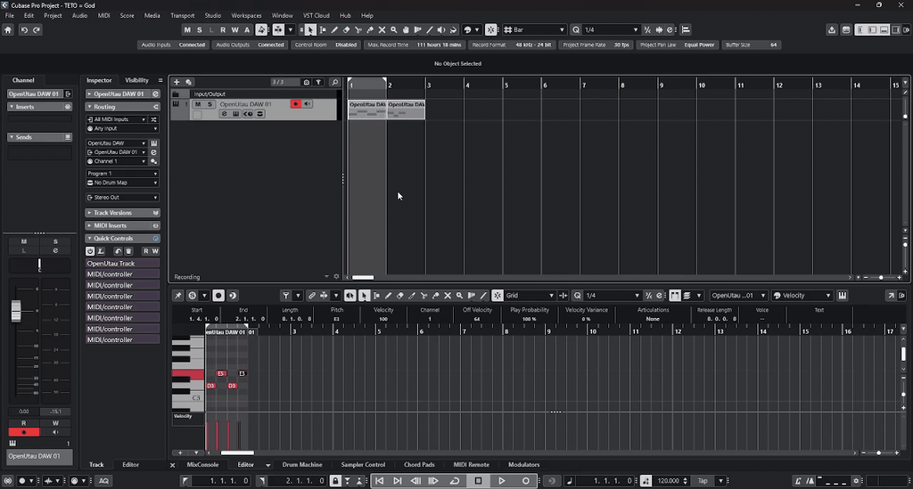
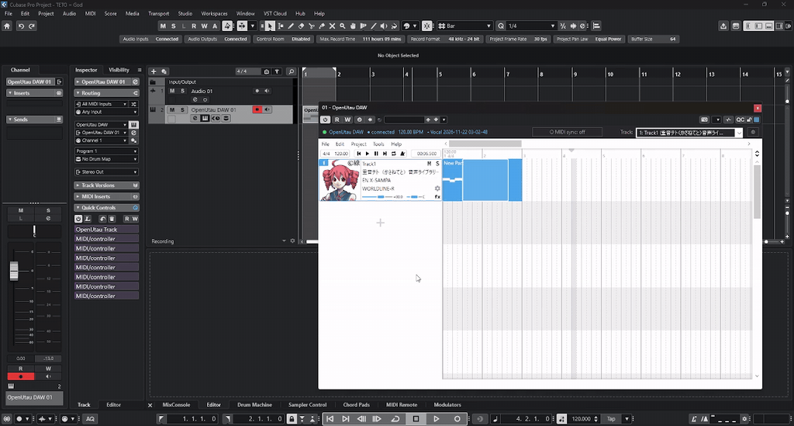
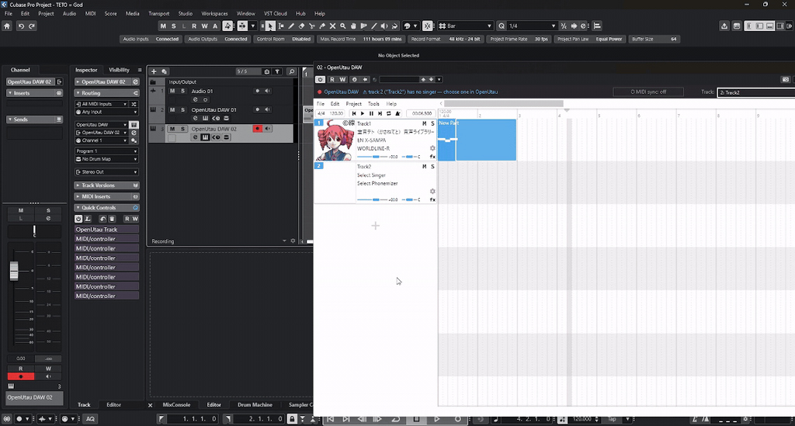
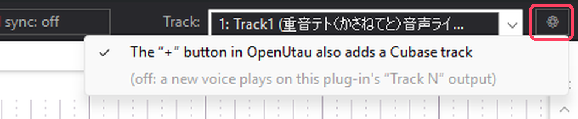

# 📖 Guía de OpenUtau DAW

[← Inicio](README.es.md)

🌍 [Русский](GUIDE.md) · [English](GUIDE-en.md) · [Українська](GUIDE-uk.md) · [日本語](GUIDE-ja.md) · **Español** · [Deutsch](GUIDE-de.md) · [Français](GUIDE-fr.md) · [Italiano](GUIDE-it.md) · [Português](GUIDE-pt.md) · [Polski](GUIDE-pl.md) · [Čeština](GUIDE-cs.md) · [Türkçe](GUIDE-tr.md) · [简体中文](GUIDE-zh.md) · [한국어](GUIDE-ko.md)

> [!NOTE]
> Esta guía se tradujo con un traductor automático: el autor no habla español. Si algo suena raro, las correcciones son bienvenidas en [Issues](https://github.com/BoBeR76/OpenUtau-DAW/issues).

OpenUtau DAW integra el editor de canto OpenUtau directamente en la ventana del plugin de Cubase. Aquí se describe lo que añade el plugin; OpenUtau funciona como siempre.

## Instalación

1. Descargue `OpenUtauDAW-Setup-2.7.3.exe` desde [Releases](https://github.com/BoBeR76/OpenUtau-DAW/releases/latest).
2. **Cierre Cubase.** Si está abierto, el instalador pedirá cerrarlo y pulsar «Reintentar».
3. En la primera página elija el idioma: también será el idioma de OpenUtau y de la barra del plugin.
4. Marque la casilla del acuerdo de licencia: sin ella «Siguiente» no se activa.

Se instalan el plugin **OpenUtau DAW** (VST3 y CLAP), el puente de tempo **OpenUtau DAW Bridge** (ARA2) y OpenUtau para DAW en `C:\OpenUtau-DAW`.

| | |
|---|---|
|  |  |

> **Actualización.** La nueva versión se instala sobre la anterior. Los ajustes de OpenUtau, los bancos de voz y los proyectos se conservan.

## Primer inicio

1. En Cubase, añada una **pista de instrumento** con el plugin **OpenUtau DAW**.
2. **OpenUtau se abre dentro de la ventana del plugin**, con una pista vacía ya creada para este plugin.
3. Elija un cantante y empiece a escribir.

> Si el plugin no aparece en la lista: *Studio → VST Plug-in Manager → volver a escanear*.

## La barra del plugin

La franja sobre OpenUtau en la ventana del plugin:

| Lo que se ve | Significado |
|---|---|
| 🟢 **conectado** | Todo listo, el sonido corresponde a las notas |
| 🟡 **renderizando 45%** | OpenUtau está preparando el sonido |
| 🔴 **⚠ …** | Algo va mal, y se indica qué, p. ej. «la pista 1 no tiene cantante: elíjalo en OpenUtau» |
| **110.00 BPM** | El tempo de Cubase que ve OpenUtau |
| **Sinc. MIDI** | Toma las notas de Cubase durante la reproducción (ver más abajo) |
| **⚙** | Ajustes del plugin |

## Notas entre Cubase y OpenUtau

### Arrastrar y soltar

- **Cubase → OpenUtau:** arrastre una parte MIDI desde la ventana de proyecto de Cubase a la ventana de OpenUtau, a la pista y el compás deseados.
- **OpenUtau → Cubase:** mantenga pulsada una parte en OpenUtau, arrástrela **fuera del borde de la ventana del plugin** y suéltela en un **espacio vacío** de una pista de Cubase.

> Si Cubase pone la parte en una pista nueva: *Edit → Preferences → MIDI → MIDI File* → active **«Import Dropped File as Single Part»**.

### Sincronizar al reproducir

1. Escriba las notas en una parte MIDI de la pista «OpenUtau DAW».
2. Active **«Sinc. MIDI»** en la barra del plugin y reproduzca el fragmento.
3. Las notas aparecen en OpenUtau. **Las sílabas ya escritas se conservan**: puede cambiar la melodía en Cubase sin perder el texto.
4. Al terminar, desactive «Sinc. MIDI».

### Las teclas se iluminan

Las notas pulsadas se ven en el piano roll de OpenUtau, como en el editor de Cubase:

- toca un **teclado MIDI** o hace clic en las teclas del editor de Cubase: esas teclas **se iluminan en OpenUtau**;
- hace clic en las teclas del piano roll de OpenUtau: la nota suena **a través de Cubase**, por la salida del plugin.

## Transporte y tempo

- **Reproducir, Detener e «Ir al inicio»** en OpenUtau (y `Espacio`, `Inicio`) controlan Cubase: suena toda la canción, no solo la voz.
- OpenUtau toma **el tempo y el compás** de Cubase: cambia el BPM y OpenUtau lo sigue.

## Puente de tempo OpenUtau DAW Bridge

Si **el tempo cambia durante la canción**, añada el puente: así OpenUtau conoce todo el mapa de tempo y compases. Una vez por proyecto:

1. Cree una pista de audio y coloque en ella cualquier evento de audio que cubra toda la canción. Enmudézcalo (Mute).
2. Seleccione el evento → *Audio → Extensions →* **«OpenUtau DAW Bridge»**.

Funciona igual que con VOCALOID.

## Varias voces

**Cada pista «OpenUtau DAW» de Cubase es una voz propia**, todas en una misma ventana de OpenUtau.

- Pista nueva «OpenUtau DAW» en Cubase → pista vacía nueva en OpenUtau.
- **«+»** en OpenUtau → pista nueva **también en Cubase**.

- **El nombre y el color** de la pista de Cubase pasan a OpenUtau.

### ⚙ Si «+» no debe crear una pista en Cubase

> [!TIP]
> **¿Necesita varias voces en una sola pista de Cubase?** Pulse **⚙** a la derecha de la barra del plugin y desmarque **«El botón «+» de OpenUtau también añade una pista en Cubase»**.
>
> Entonces «+» añade la voz solo en OpenUtau, y esta suena por la salida **«Track N»** del mismo plugin (actívela en **F11**).

## Guardado y copias de seguridad

- **La voz se guarda automáticamente con el proyecto de Cubase.**
- Se conservan **las 10 últimas versiones**. Para restaurar una: *Archivo →* **«Restaurar desde copia de seguridad»**.

## Pequeños detalles útiles

- 🔁 **Reinicio automático.** Si OpenUtau falla, el plugin lo reinicia. La voz no se pierde.
- 🔔 **Versiones nuevas.** Cuando sale una actualización, la barra del plugin muestra un botón «⬆ Actualización» que abre la página de descarga. Se desactiva en ⚙.
- 🪟 **Ventanas sobre el plugin.** Preferencias, cantantes y mensajes de OpenUtau se abren sobre la ventana del plugin: Cubase no la oculta.
- 🎚 **Salidas separadas.** 8 salidas estéreo «Track 1…8», una por pista de OpenUtau (se activan en F11).
- ⏳ **La exportación espera al render.** Si OpenUtau aún prepara el sonido, Audio Mixdown espera.
- ⚡ **Sin ventanas de más.** Dentro de Cubase, OpenUtau omite la página de inicio y abre directamente la voz del proyecto.
- 🌍 **14 idiomas**, y la barra del plugin usa el mismo idioma que OpenUtau.

## Aún no es posible

- **Escribir notas en el editor propio de Cubase** (como con VOCALOID) y la sincronización bidireccional en vivo. Esto espera a ARA 3: se hará en cuanto Celemony lo publique.
- Los marcadores de Cubase no están disponibles para los plugins, por lo que OpenUtau no los muestra.

## Preguntas frecuentes

**El instalador dice que Cubase está abierto.** Cierre Cubase por completo (el proceso tarda unos segundos en cerrarse tras la ventana) y pulse «Reintentar».

**No hay sonido.** Mire el punto de la barra del plugin: 🔴 — al lado se indica la causa; 🟡 — espere a que termine el render.

**El plugin no aparece en la lista.** *Studio → VST Plug-in Manager → volver a escanear*.

**«OpenUtau está abierto en otra ventana del plugin».** Haga clic en el mensaje: OpenUtau se moverá a esta ventana.
