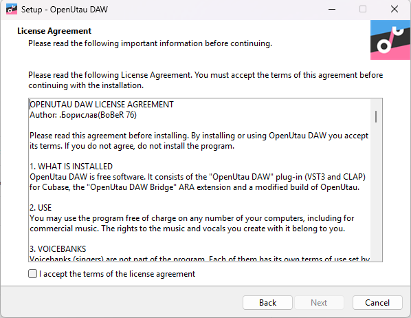
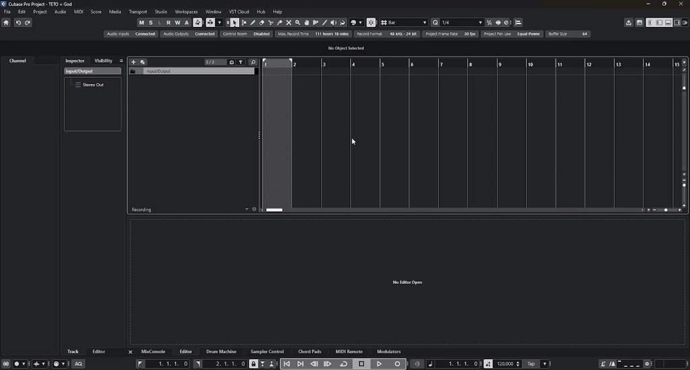
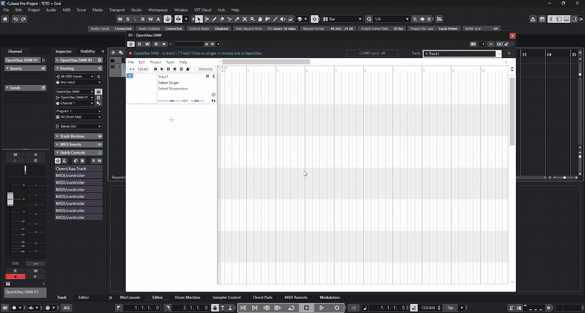
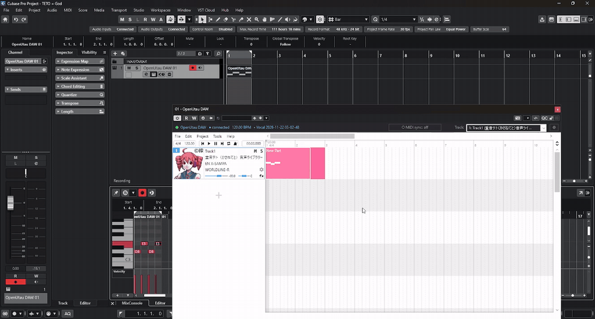
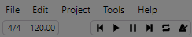
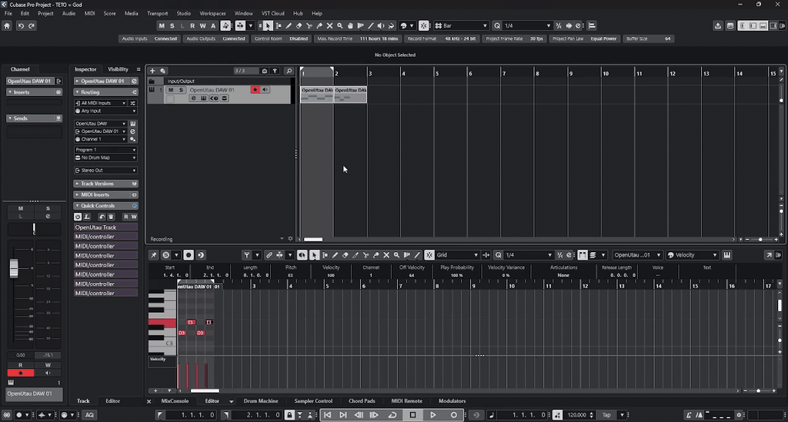
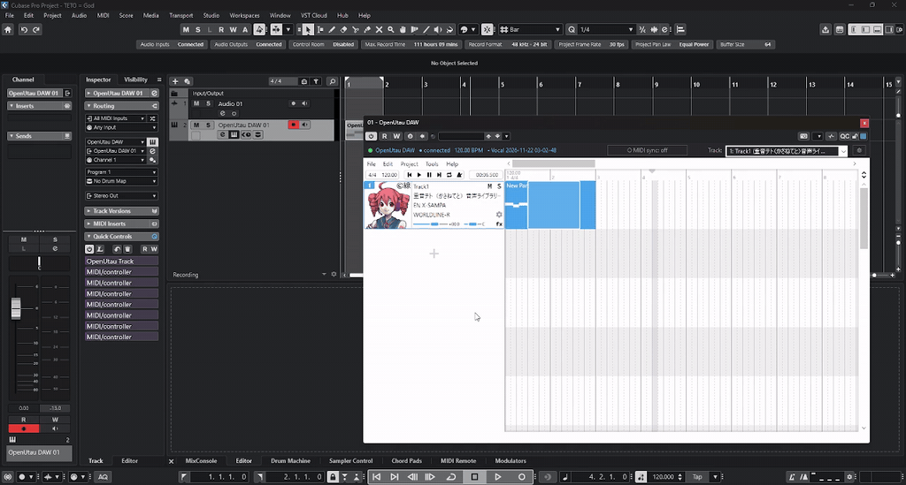
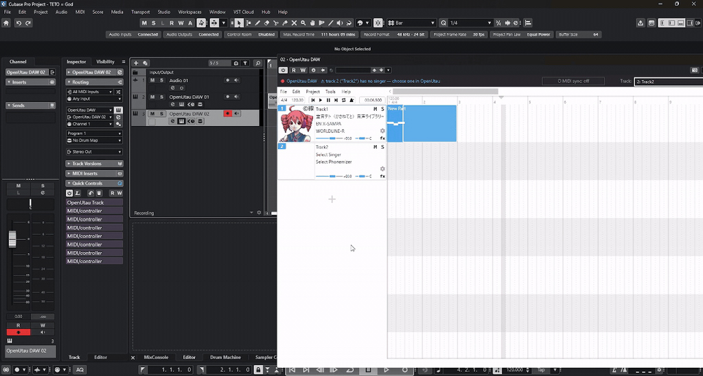
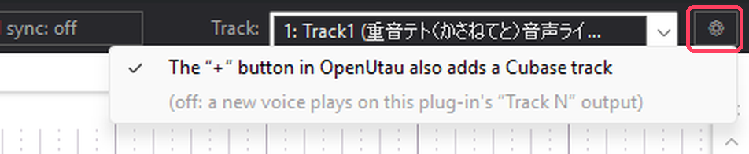

# 📖 Guide d'OpenUtau DAW

[← Accueil](README.fr.md)

🌍 [Русский](GUIDE.md) · [English](GUIDE-en.md) · [Українська](GUIDE-uk.md) · [日本語](GUIDE-ja.md) · [Español](GUIDE-es.md) · [Deutsch](GUIDE-de.md) · **Français** · [Italiano](GUIDE-it.md) · [Português](GUIDE-pt.md) · [Polski](GUIDE-pl.md) · [Čeština](GUIDE-cs.md) · [Türkçe](GUIDE-tr.md) · [简体中文](GUIDE-zh.md) · [한국어](GUIDE-ko.md)

> [!NOTE]
> Ce guide a été traduit avec un traducteur automatique : l’auteur ne parle pas français. Les corrections sont les bienvenues dans les [Issues](https://github.com/BoBeR76/OpenUtau-DAW/issues).

OpenUtau DAW intègre l'éditeur de chant OpenUtau directement dans la fenêtre du plugin de Cubase. Ce guide décrit ce qu'ajoute le plugin ; OpenUtau lui-même fonctionne comme d'habitude.

## Installation

1. Téléchargez `OpenUtauDAW-Setup-2.7.3.exe` depuis [Releases](https://github.com/BoBeR76/OpenUtau-DAW/releases/latest).
2. **Fermez Cubase.** S'il est ouvert, l'installateur demande de le fermer puis de cliquer sur « Réessayer ».
3. Choisissez la langue sur la première page : ce sera aussi la langue d'OpenUtau et de la barre du plugin.
4. Cochez la case du contrat de licence : sans elle, « Suivant » reste inactif.

Sont installés le plugin **OpenUtau DAW** (VST3 et CLAP), le pont de tempo **OpenUtau DAW Bridge** (ARA2) et OpenUtau pour DAW dans `C:\OpenUtau-DAW`.

| | |
|---|---|
|  |  |

> **Mise à jour.** La nouvelle version s'installe par-dessus l'ancienne. Les réglages d'OpenUtau, les banques de voix et les projets sont conservés.

## Premier démarrage

1. Dans Cubase, ajoutez une **piste d'instrument** avec le plugin **OpenUtau DAW**.
2. **OpenUtau s'ouvre directement dans la fenêtre du plugin**, avec une piste vide déjà créée pour ce plugin.
3. Choisissez un chanteur, et c'est parti.

> Si le plugin n'est pas dans la liste : *Studio → VST Plug-in Manager → relancer l'analyse*.

## La barre du plugin

La bande au-dessus d'OpenUtau dans la fenêtre du plugin :

| Affichage | Signification |
|---|---|
| 🟢 **connecté** | Tout est prêt, le son correspond aux notes |
| 🟡 **rendu 45 %** | OpenUtau prépare le son |
| 🔴 **⚠ …** | Un problème — avec son explication, p. ex. « la piste 1 n'a pas de chanteur — choisissez-le dans OpenUtau » |
| **110.00 BPM** | Le tempo de Cubase vu par OpenUtau |
| **Synchro MIDI** | Récupère les notes de Cubase pendant la lecture (voir plus bas) |
| **⚙** | Réglages du plugin |

## Notes entre Cubase et OpenUtau

### Glisser-déposer

- **Cubase → OpenUtau :** faites glisser un conteneur MIDI de la fenêtre de projet de Cubase vers la fenêtre d'OpenUtau, sur la piste et la mesure voulues.
- **OpenUtau → Cubase :** maintenez une partie dans OpenUtau, faites-la glisser **au-delà du bord de la fenêtre du plugin** et déposez-la sur un **endroit vide** d'une piste Cubase.

> Si Cubase place le conteneur sur une nouvelle piste : *Édition → Préférences → MIDI → Fichier MIDI* → activez **« Importer le fichier déposé comme conteneur unique »**.

### Synchronisation pendant la lecture

1. Écrivez les notes dans un conteneur MIDI de la piste « OpenUtau DAW ».
2. Activez **« Synchro MIDI »** dans la barre du plugin et lisez le passage.
3. Les notes apparaissent dans OpenUtau. **Les syllabes déjà saisies sont conservées** : vous pouvez modifier la mélodie dans Cubase sans perdre le texte.
4. Ensuite, désactivez « Synchro MIDI ».

### Les touches s'allument

Les notes enfoncées s'affichent dans le piano roll d'OpenUtau, comme dans l'éditeur de Cubase :

- vous jouez sur un **clavier MIDI** ou cliquez sur les touches de l'éditeur de Cubase : ces touches **s'allument dans OpenUtau** ;
- vous cliquez sur les touches du piano roll d'OpenUtau : la note sonne **via Cubase**, sur la sortie du plugin.

## Transport et tempo

- **Lecture, Stop et « retour au début »** dans OpenUtau (ainsi que `Espace`, `Début`) pilotent Cubase : toute la chanson joue, pas seulement la voix.
- OpenUtau reprend **le tempo et la mesure** de Cubase : changez le BPM, OpenUtau suit.

## Pont de tempo OpenUtau DAW Bridge

Si **le tempo change au cours de la chanson**, ajoutez le pont : OpenUtau connaîtra alors toute la carte de tempo et de mesures. Une fois par projet :

1. Créez une piste audio et placez-y un événement audio quelconque couvrant toute la chanson. Rendez-le muet (Mute).
2. Sélectionnez l'événement → *Audio → Extensions →* **« OpenUtau DAW Bridge »**.

Le pont fonctionne comme avec VOCALOID.

## Plusieurs voix

**Chaque piste « OpenUtau DAW » de Cubase est une voix à part**, toutes dans une seule fenêtre OpenUtau.

- Nouvelle piste « OpenUtau DAW » dans Cubase → nouvelle piste vide dans OpenUtau.
- **« + »** dans OpenUtau → nouvelle piste **aussi dans Cubase**.

- **Le nom et la couleur** de la piste Cubase sont repris dans OpenUtau.

### ⚙ Si « + » ne doit pas créer de piste dans Cubase

> [!TIP]
> **Plusieurs voix sur une seule piste Cubase ?** Cliquez sur **⚙** à droite de la barre du plugin et décochez **« Le bouton « + » d'OpenUtau ajoute aussi une piste dans Cubase »**.
>
> « + » ajoute alors la voix uniquement dans OpenUtau, et elle sonne sur la sortie **« Track N »** du même plugin (à activer dans **F11**).

## Enregistrement et sauvegardes

- **La voix est enregistrée automatiquement avec le projet Cubase.**
- Les **10 dernières versions** sont conservées. Pour en restaurer une : *Fichier →* **« Restaurer depuis une sauvegarde »**.

## Petits plus

- 🔁 **Redémarrage automatique.** Si OpenUtau plante, le plugin le relance. La voix n'est pas perdue.
- 🔔 **Nouvelles versions.** Quand une mise à jour sort, la barre du plugin affiche un bouton « ⬆ Mise à jour » qui ouvre la page de téléchargement. Désactivable dans ⚙.
- 🪟 **Fenêtres au-dessus du plugin.** Préférences, chanteurs et messages d'OpenUtau s'ouvrent au-dessus de la fenêtre du plugin : Cubase ne la masque pas.
- 🎚 **Sorties séparées.** 8 sorties stéréo « Track 1…8 », une par piste OpenUtau (à activer dans F11).
- ⏳ **L'export attend le rendu.** Si OpenUtau prépare encore le son, l'Audio Mixdown attend.
- ⚡ **Pas de fenêtres en trop.** Dans Cubase, OpenUtau saute sa page d'accueil et ouvre directement la voix du projet.
- 🌍 **14 langues**, et la barre du plugin parle la même langue qu'OpenUtau.

## Pas encore possible

- **Écrire les notes dans l'éditeur de Cubase** (comme avec VOCALOID) et la synchronisation bidirectionnelle en direct. Cela attend ARA 3 : ce sera fait dès que Celemony le publiera.
- Les marqueurs de Cubase ne sont pas accessibles aux plugins ; OpenUtau ne peut donc pas les afficher.

## Questions fréquentes

**L'installateur indique que Cubase est lancé.** Fermez complètement Cubase (le processus reste quelques secondes après la fenêtre) et cliquez sur « Réessayer ».

**Pas de son.** Regardez le point dans la barre du plugin : 🔴 — la raison est écrite à côté ; 🟡 — attendez la fin du rendu.

**Le plugin n'est pas dans la liste.** *Studio → VST Plug-in Manager → relancer l'analyse*.

**« OpenUtau est ouvert dans une autre fenêtre du plugin ».** Cliquez sur le message : OpenUtau passera dans cette fenêtre.
