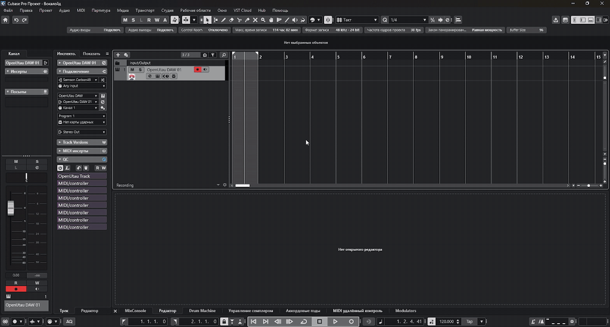

# 📖 OpenUtau DAW ガイド

[← ホーム](../README.md)

🌍 [Русский](GUIDE.md) · [English](GUIDE-en.md) · [Українська](GUIDE-uk.md) · **日本語** · [Español](GUIDE-es.md) · [Deutsch](GUIDE-de.md) · [Français](GUIDE-fr.md) · [Italiano](GUIDE-it.md) · [Português](GUIDE-pt.md) · [Polski](GUIDE-pl.md) · [Čeština](GUIDE-cs.md) · [Türkçe](GUIDE-tr.md) · [简体中文](GUIDE-zh.md) · [한국어](GUIDE-ko.md)

> [!NOTE]
> このガイドは機械翻訳で作成しました。作者は日本語を話せません。不自然な箇所があれば [Issues](https://github.com/BoBeR76/OpenUtau-DAW/issues) で修正をお知らせください。

OpenUtau DAW は、歌声合成エディター OpenUtau を Cubase のプラグインウィンドウの中に組み込みます。ここではプラグインが追加する機能を説明します。OpenUtau 自体の使い方は通常どおりです。*（アニメーションはロシア語の画面です。）*

## インストール

1. [Releases](https://github.com/BoBeR76/OpenUtau-DAW/releases/latest) から `OpenUtauDAW-Setup-2.7.0.exe` をダウンロードします。
2. **Cubase を終了します。** 起動中の場合、インストーラーが終了して「再試行」を押すよう求めます。
3. 最初のページで言語を選びます。OpenUtau とプラグインバーの言語にもなります。
4. 使用許諾契約のチェックボックスをオンにします。オンにしないと「次へ」は押せません。

インストールされるもの: プラグイン **OpenUtau DAW**（VST3 と CLAP）、テンポブリッジ **OpenUtau DAW Bridge**（ARA2）、`C:\OpenUtau-DAW` の DAW 用 OpenUtau。

| | |
|---|---|
|  |  |

> **アップデート。** 新しいバージョンは古いバージョンに上書きでインストールされます。OpenUtau の設定、音源、プロジェクトはそのまま残ります。

## はじめに

1. Cubase で **OpenUtau DAW** プラグインを挿した **Instrument トラック** を追加します。
2. **OpenUtau がプラグインウィンドウの中に開き**、このプラグイン用の空のトラックが自動で作られます。
3. 歌手を選べば、すぐに書き始められます。

> プラグインが一覧にない場合: *Studio → VST Plug-in Manager → 再スキャン*。

## プラグインバー

プラグインウィンドウで OpenUtau の上にあるバー:

| 表示 | 意味 |
|---|---|
| 🟢 **接続済み** | 準備完了。音がノートと一致しています |
| 🟡 **レンダリング 45%** | OpenUtau が音を準備中 |
| 🔴 **⚠ …** | 問題があり、内容が表示されます。例:「トラック 1 に歌手がいません — OpenUtau で選んでください」 |
| **110.00 BPM** | OpenUtau が受け取っている Cubase のテンポ |
| **MIDI 同期** | 再生中に Cubase のノートを取り込みます（下記参照） |
| **⚙** | プラグインの設定 |

## Cubase と OpenUtau の間でノートをやり取りする

### ドラッグ＆ドロップ

- **Cubase → OpenUtau:** Cubase のプロジェクトウィンドウから MIDI パートを OpenUtau のウィンドウへ、目的のトラックと小節にドラッグします。
- **OpenUtau → Cubase:** OpenUtau のパートをつかみ、**プラグインウィンドウの外へ**ドラッグして、Cubase のトラックの**空いている場所**で離します。

> Cubase がパートを新しいトラックに置いてしまう場合: *Edit → Preferences → MIDI → MIDI File* →「**Import Dropped File as Single Part**」をオンにします。

### 再生中の同期

1. 「OpenUtau DAW」トラックの MIDI パートにノートを書きます。
2. プラグインバーの「**MIDI 同期**」をオンにして、その部分を再生します。
3. ノートが OpenUtau に現れます。**入力済みの歌詞はそのまま残る**ので、歌詞を失わずに Cubase でメロディーを直せます。
4. 終わったら「MIDI 同期」をオフにします。

### 鍵盤が光る

押しているノートが、Cubase のエディターと同じように OpenUtau のピアノロールに表示されます:

- **MIDI キーボード**を弾くか、Cubase のエディターの鍵盤をクリックすると、その鍵盤が **OpenUtau で光ります**。
- OpenUtau のピアノロールの鍵盤をクリックすると、ノートがプラグインの出力から **Cubase 経由で**鳴ります。

## トランスポートとテンポ

- OpenUtau の**再生・停止・先頭へ戻る**（および `Space`、`Home`）で Cubase を操作できます。ボーカルだけでなく曲全体が鳴ります。
- OpenUtau は **テンポと拍子** を Cubase から受け取ります。BPM を変えれば OpenUtau も追従します。

## テンポブリッジ OpenUtau DAW Bridge

**曲の途中でテンポが変わる**場合はブリッジを追加します。これで OpenUtau がテンポと小節の全体マップを把握します。プロジェクトごとに 1 回:

1. オーディオトラックを作り、曲の長さいっぱいに任意のオーディオイベントを置いてミュートします。
2. そのイベントを選択 → *Audio → Extensions →*「**OpenUtau DAW Bridge**」。

VOCALOID と同じ仕組みです。

## 複数の声

**Cubase の「OpenUtau DAW」トラックはそれぞれ別の声**で、すべて 1 つの OpenUtau ウィンドウにまとまります。

- Cubase で「OpenUtau DAW」トラックを追加 → OpenUtau に空のトラックが追加されます。
- OpenUtau の **「+」** → **Cubase にも**トラックが追加されます。

- Cubase のトラックの**名前と色**が OpenUtau に反映されます。

### ⚙「+」で Cubase にトラックを作らない場合

> [!TIP]
> **1 つの Cubase トラックで複数の声を使いたい場合は?** プラグインバーの右端の **⚙** をクリックし、「**OpenUtau の「+」ボタンで Cubase にもトラックを追加**」のチェックを外します。
>
> すると「+」は OpenUtau にだけ声を追加し、その声は同じプラグインの **「Track N」** 出力から鳴ります（**F11** で有効にします）。

## 保存とバックアップ

- **ボーカルは Cubase のプロジェクトと一緒に自動で保存されます。**
- **直近 10 個のバージョン**が保管されます。復元: *ファイル →*「**バックアップから復元**」。

## ちょっとうれしいこと

- 🔁 **自動再起動。** OpenUtau が落ちても、プラグインが再起動します。ボーカルは失われません。
- 🪟 **プラグインの上に開くウィンドウ。** OpenUtau の設定、歌手、メッセージはプラグインウィンドウの上に開くので、Cubase に隠されません。
- 🎚 **個別出力。** OpenUtau のトラックごとに 1 つ、ステレオ出力「Track 1…8」が 8 つ（F11 で有効化）。
- ⏳ **書き出しはレンダリングを待ちます。** OpenUtau がまだ音を準備中なら、Audio Mixdown は待機します。
- ⚡ **余計なウィンドウなし。** Cubase 内では OpenUtau はスタートページを出さず、すぐにプロジェクトのボーカルを開きます。
- 🌍 **14 言語**に対応し、プラグインバーも OpenUtau と同じ言語になります。

## まだできないこと

- **Cubase 内蔵のエディターでノートを書くこと**（VOCALOID のように）と、リアルタイムの双方向ノート同期。これは ARA 3 待ちです。Celemony が公開したら対応します。
- Cubase のマーカーはプラグインから取得できないため、OpenUtau には表示されません。

## よくある質問

**インストーラーに Cubase が起動中と表示される。** Cubase を完全に終了し（ウィンドウを閉じてもプロセスが数秒残ります）、「再試行」を押してください。

**音が出ない。** プラグインバーの丸印を確認してください。🔴 — 横に原因が表示されています。🟡 — レンダリングの完了を待ってください。

**プラグインが一覧にない。** *Studio → VST Plug-in Manager → 再スキャン*。

**「OpenUtau は別のプラグインウィンドウで開いています」と表示される。** メッセージをクリックすると、OpenUtau がこのウィンドウに移ります。
