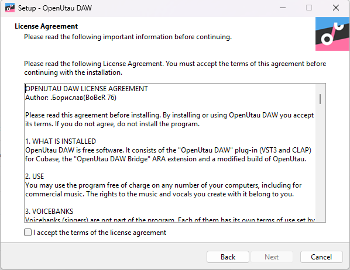
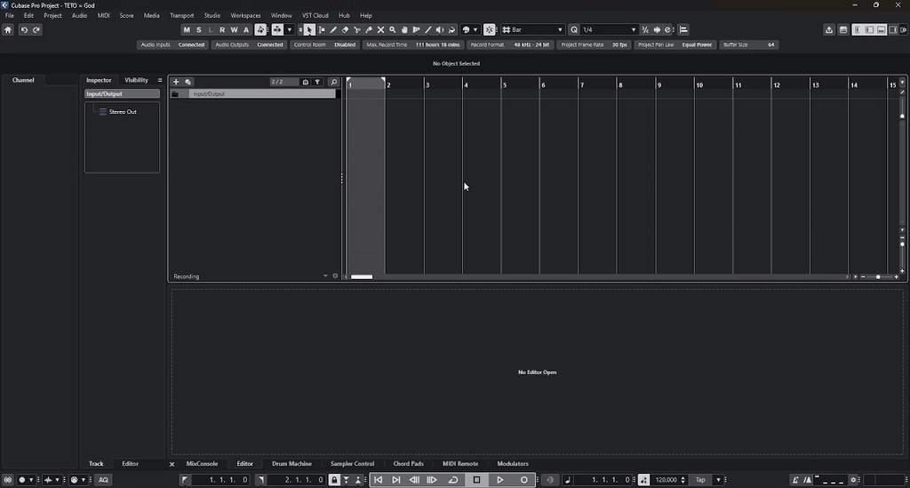
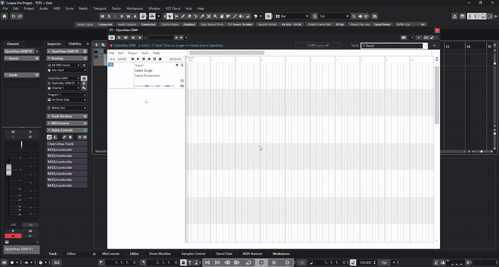
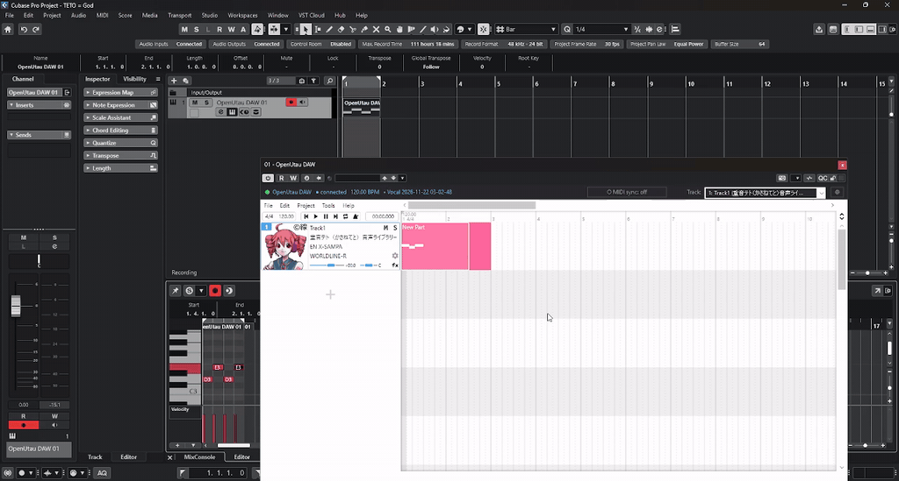
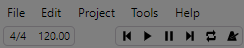
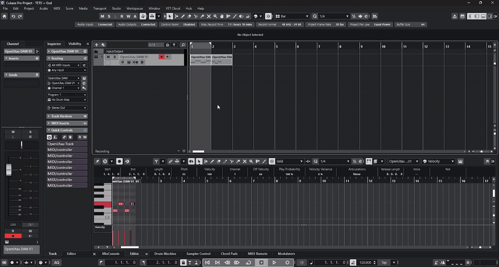
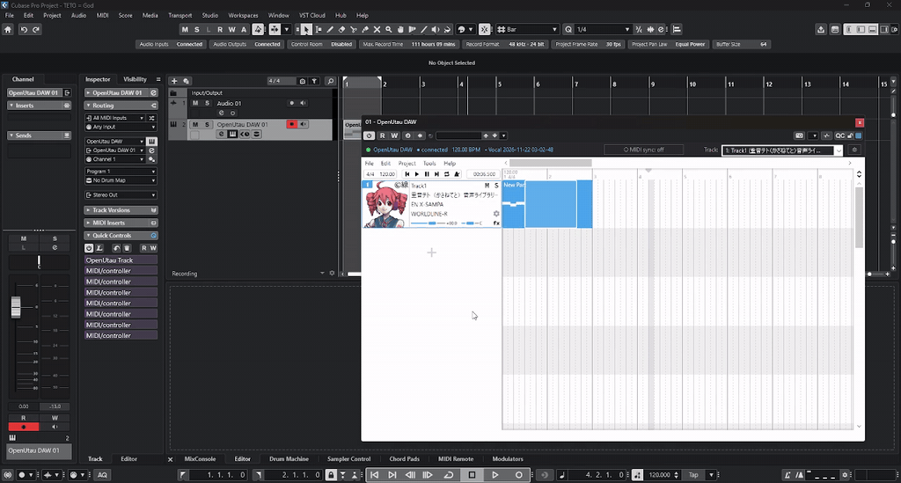
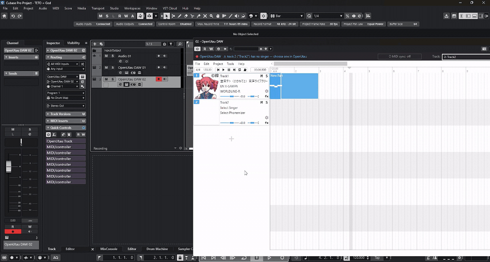
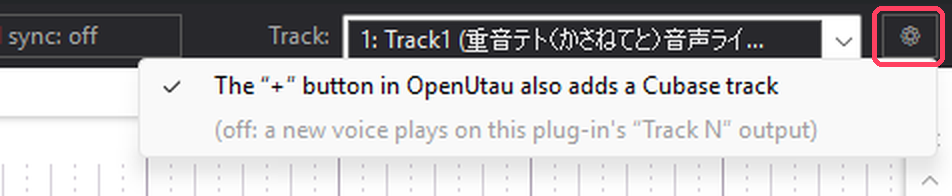

# 📖 OpenUtau DAW 사용 설명서

[← 홈](README.ko.md)

🌍 [Русский](GUIDE.md) · [English](GUIDE-en.md) · [Українська](GUIDE-uk.md) · [日本語](GUIDE-ja.md) · [Español](GUIDE-es.md) · [Deutsch](GUIDE-de.md) · [Français](GUIDE-fr.md) · [Italiano](GUIDE-it.md) · [Português](GUIDE-pt.md) · [Polski](GUIDE-pl.md) · [Čeština](GUIDE-cs.md) · [Türkçe](GUIDE-tr.md) · [简体中文](GUIDE-zh.md) · **한국어**

> [!NOTE]
> 이 설명서는 기계 번역으로 작성되었습니다. 작성자는 한국어를 하지 못합니다. 어색한 부분은 [Issues](https://github.com/BoBeR76/OpenUtau-DAW/issues)에서 알려 주세요.

OpenUtau DAW는 노래 합성 편집기 OpenUtau를 Cubase 플러그인 창 안에 바로 넣어 줍니다. 여기서는 플러그인이 추가하는 기능을 설명합니다. OpenUtau 자체는 평소대로 동작합니다.

## 설치

1. [Releases](https://github.com/BoBeR76/OpenUtau-DAW/releases/latest)에서 `OpenUtauDAW-Setup-2.7.3.exe`를 내려받습니다.
2. **Cubase를 종료합니다.** 실행 중이면 설치 프로그램이 종료한 뒤 “다시 시도”를 누르라고 안내합니다.
3. 첫 페이지에서 언어를 고릅니다. 이 언어가 OpenUtau와 플러그인 바의 언어도 됩니다.
4. 사용권 계약 체크박스를 선택합니다. 선택하지 않으면 “다음”을 누를 수 없습니다.

설치 항목: 플러그인 **OpenUtau DAW**(VST3, CLAP), 템포 브리지 **OpenUtau DAW Bridge**(ARA2), `C:\OpenUtau-DAW`의 DAW용 OpenUtau.

| | |
|---|---|
|  |  |

> **업데이트.** 새 버전은 이전 버전 위에 덮어서 설치됩니다. OpenUtau 설정, 음원, 프로젝트는 그대로 유지됩니다.

## 처음 시작하기

1. Cubase에서 **OpenUtau DAW** 플러그인을 넣은 **Instrument 트랙**을 추가합니다.
2. **OpenUtau가 플러그인 창 안에서 바로 열리고**, 이 플러그인용 빈 트랙이 자동으로 만들어집니다.
3. 가수를 고르면 바로 작업할 수 있습니다.

> 목록에 플러그인이 없으면: *Studio → VST Plug-in Manager → 다시 검색*.

## 플러그인 바

플러그인 창에서 OpenUtau 위에 있는 막대:

| 표시 | 의미 |
|---|---|
| 🟢 **연결됨** | 준비 완료, 소리가 음표와 일치합니다 |
| 🟡 **렌더링 45%** | OpenUtau가 소리를 준비하는 중 |
| 🔴 **⚠ …** | 문제가 있으며 내용이 표시됩니다. 예: “트랙 1에 가수가 없습니다 — OpenUtau에서 선택하세요” |
| **110.00 BPM** | OpenUtau가 받은 Cubase 템포 |
| **MIDI 동기화** | 재생 중 Cubase의 음표를 가져옵니다(아래 참고) |
| **⚙** | 플러그인 설정 |

## Cubase와 OpenUtau 사이의 음표

### 끌어다 놓기

- **Cubase → OpenUtau:** Cubase 프로젝트 창의 MIDI 파트를 OpenUtau 창의 원하는 트랙과 마디로 끌어다 놓습니다.
- **OpenUtau → Cubase:** OpenUtau에서 파트를 잡고 **플러그인 창 가장자리 밖으로** 끌어낸 뒤, Cubase 트랙의 **빈 곳**에 놓습니다.

> Cubase가 파트를 새 트랙에 놓는다면: *Edit → Preferences → MIDI → MIDI File* → **“Import Dropped File as Single Part”**를 켭니다.

### 재생 중 동기화

1. “OpenUtau DAW” 트랙의 MIDI 파트에 음표를 씁니다.
2. 플러그인 바에서 **“MIDI 동기화”**를 켜고 필요한 구간을 재생합니다.
3. 음표가 OpenUtau에 나타납니다. **이미 입력한 가사는 유지되므로** 가사를 잃지 않고 Cubase에서 멜로디를 고칠 수 있습니다.
4. 끝나면 “MIDI 동기화”를 끕니다.

### 건반이 켜집니다

누르고 있는 음이 Cubase 편집기처럼 OpenUtau 피아노 롤에 표시됩니다:

- **MIDI 키보드**를 연주하거나 Cubase 편집기의 건반을 클릭하면 그 건반이 **OpenUtau에서 켜집니다**;
- OpenUtau 피아노 롤의 건반을 클릭하면 음이 플러그인 출력을 통해 **Cubase에서** 울립니다.

## 트랜스포트와 템포

- OpenUtau의 **재생, 정지, “처음으로”**(및 `Space`, `Home`)가 Cubase를 제어합니다. 보컬만이 아니라 곡 전체가 재생됩니다.
- OpenUtau는 **템포와 박자표**를 Cubase에서 가져옵니다. BPM을 바꾸면 OpenUtau도 따라갑니다.

## 템포 브리지 OpenUtau DAW Bridge

**곡 중간에 템포가 바뀐다면** 브리지를 추가하세요. 그러면 OpenUtau가 템포와 마디 전체 정보를 알게 됩니다. 프로젝트마다 한 번:

1. 오디오 트랙을 만들고 곡 전체 길이의 아무 오디오 이벤트나 올린 뒤 음소거(Mute)합니다.
2. 이벤트 선택 → *Audio → Extensions →* **“OpenUtau DAW Bridge”**.

VOCALOID와 같은 방식으로 동작합니다.

## 여러 목소리

**Cubase의 “OpenUtau DAW” 트랙 하나하나가 별도의 목소리**이며, 모두 하나의 OpenUtau 창에 있습니다.

- Cubase에 새 “OpenUtau DAW” 트랙 → OpenUtau에 새 빈 트랙.
- OpenUtau의 **“+”** → **Cubase에도** 새 트랙.

- Cubase 트랙의 **이름과 색**이 OpenUtau에 반영됩니다.

### ⚙ “+”로 Cubase 트랙을 만들지 않으려면

> [!TIP]
> **Cubase 트랙 하나에 여러 목소리가 필요하신가요?** 플러그인 바 오른쪽의 **⚙**를 누르고 **“OpenUtau의 “+” 버튼으로 Cubase에도 트랙 추가”** 체크를 해제하세요.
>
> 그러면 “+”는 OpenUtau에만 목소리를 추가하고, 그 목소리는 같은 플러그인의 **“Track N”** 출력으로 나옵니다(**F11**에서 활성화).

## 저장과 백업

- **보컬은 Cubase 프로젝트와 함께 자동으로 저장됩니다.**
- **최근 10개 버전**이 보관됩니다. 복원: *파일 →* **“백업에서 복원”**.

## 알아 두면 좋은 점

- 🔁 **자동 재시작.** OpenUtau가 멈추면 플러그인이 다시 시작합니다. 보컬은 사라지지 않습니다.
- 🔔 **새 버전 알림.** 업데이트가 나오면 플러그인 바에 다운로드 페이지를 여는 “⬆ 업데이트” 버튼이 나타납니다. ⚙에서 끌 수 있습니다.
- 🪟 **플러그인 위에 열리는 창.** OpenUtau의 설정, 가수, 메시지 창은 플러그인 창 위에 열리므로 Cubase가 숨기지 않습니다.
- 🎚 **개별 출력.** OpenUtau 트랙마다 하나씩, 스테레오 출력 “Track 1…8” 8개(F11에서 활성화).
- ⏳ **내보내기는 렌더링을 기다립니다.** OpenUtau가 아직 소리를 준비 중이면 Audio Mixdown이 기다립니다.
- ⚡ **불필요한 창 없음.** Cubase 안에서 OpenUtau는 시작 페이지를 건너뛰고 프로젝트 보컬을 바로 엽니다.
- 🌍 **14개 언어**, 플러그인 바도 OpenUtau와 같은 언어로 표시됩니다.

## 아직 안 되는 것

- **Cubase 자체 편집기에서 음표 쓰기**(VOCALOID처럼)와 실시간 양방향 음표 동기화. ARA 3를 기다리고 있으며, Celemony가 공개하면 바로 구현할 예정입니다.
- Cubase 마커는 플러그인에서 접근할 수 없어 OpenUtau에 표시되지 않습니다.

## 자주 묻는 질문

**설치 프로그램이 Cubase가 실행 중이라고 합니다.** Cubase를 완전히 종료하고(창을 닫은 뒤에도 프로세스가 몇 초 남아 있습니다) “다시 시도”를 누르세요.

**소리가 나지 않습니다.** 플러그인 바의 점을 확인하세요. 🔴 — 옆에 원인이 적혀 있습니다. 🟡 — 렌더링이 끝날 때까지 기다리세요.

**플러그인이 목록에 없습니다.** *Studio → VST Plug-in Manager → 다시 검색*.

**“OpenUtau가 다른 플러그인 창에서 열려 있습니다”.** 메시지를 클릭하면 OpenUtau가 이 창으로 옮겨집니다.
