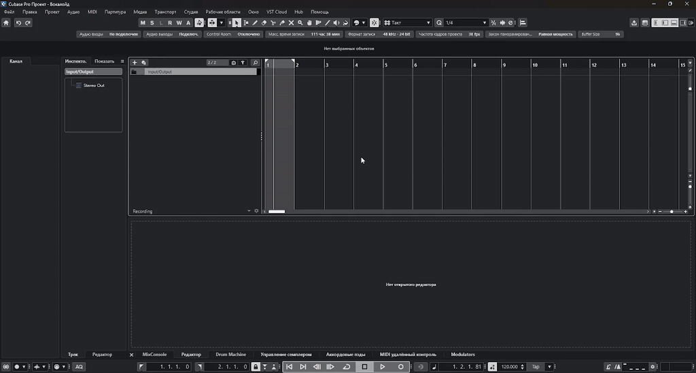
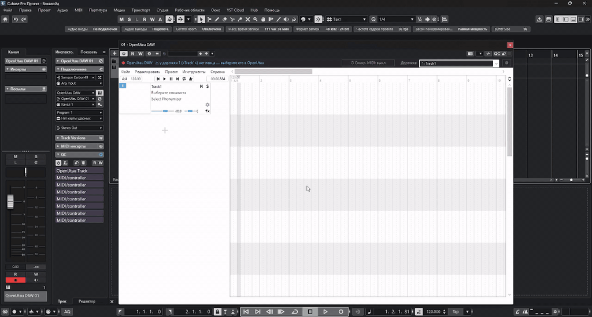

# 📖 Instrukcja OpenUtau DAW

[← Strona główna](../README.md)

🌍 [Русский](GUIDE.md) · [English](GUIDE-en.md) · [Українська](GUIDE-uk.md) · [日本語](GUIDE-ja.md) · [Español](GUIDE-es.md) · [Deutsch](GUIDE-de.md) · [Français](GUIDE-fr.md) · [Italiano](GUIDE-it.md) · [Português](GUIDE-pt.md) · **Polski** · [Čeština](GUIDE-cs.md) · [Türkçe](GUIDE-tr.md) · [简体中文](GUIDE-zh.md) · [한국어](GUIDE-ko.md)

> [!NOTE]
> Ta instrukcja została przetłumaczona tłumaczem maszynowym: autor nie zna języka polskiego. Poprawki mile widziane w [Issues](https://github.com/BoBeR76/OpenUtau-DAW/issues).

OpenUtau DAW osadza edytor śpiewu OpenUtau bezpośrednio w oknie wtyczki Cubase. Tu opisano to, co dodaje wtyczka; sam OpenUtau działa jak zwykle. *(Animacje pokazują interfejs po rosyjsku.)*

## Instalacja

1. Pobierz `OpenUtauDAW-Setup-2.7.1.exe` z [Releases](https://github.com/BoBeR76/OpenUtau-DAW/releases/latest).
2. **Zamknij Cubase.** Jeśli jest otwarty, instalator poprosi o jego zamknięcie i kliknięcie „Ponów”.
3. Na pierwszej stronie wybierz język — będzie to też język OpenUtau i paska wtyczki.
4. Zaznacz pole umowy licencyjnej — bez tego „Dalej” jest nieaktywne.

Instalowane są: wtyczka **OpenUtau DAW** (VST3 i CLAP), most tempa **OpenUtau DAW Bridge** (ARA2) oraz OpenUtau dla DAW w `C:\OpenUtau-DAW`.

| | |
|---|---|
|  |  |

> **Aktualizacja.** Nowa wersja instaluje się na starej. Ustawienia OpenUtau, banki głosów i projekty pozostają bez zmian.

## Pierwsze uruchomienie

1. W Cubase dodaj **ścieżkę instrumentu** z wtyczką **OpenUtau DAW**.
2. **OpenUtau otworzy się bezpośrednio w oknie wtyczki**, z pustą ścieżką już utworzoną dla tej wtyczki.
3. Wybierz śpiewaka i zaczynaj.

> Jeśli wtyczki nie ma na liście: *Studio → VST Plug-in Manager → skanuj ponownie*.

## Pasek wtyczki

Pasek nad OpenUtau w oknie wtyczki:

| Co widać | Co oznacza |
|---|---|
| 🟢 **połączono** | Wszystko gotowe, dźwięk odpowiada nutom |
| 🟡 **renderowanie 45%** | OpenUtau przygotowuje dźwięk |
| 🔴 **⚠ …** | Coś jest nie tak — i jest napisane co, np. „ścieżka 1 nie ma śpiewaka — wybierz go w OpenUtau” |
| **110.00 BPM** | Tempo Cubase widziane przez OpenUtau |
| **Synch. MIDI** | Pobiera nuty z Cubase podczas odtwarzania (zob. niżej) |
| **⚙** | Ustawienia wtyczki |

## Nuty między Cubase a OpenUtau

### Przeciąganie

- **Cubase → OpenUtau:** przeciągnij partię MIDI z okna projektu Cubase do okna OpenUtau, na wybraną ścieżkę i takt.
- **OpenUtau → Cubase:** przytrzymaj partię w OpenUtau, przeciągnij ją **poza krawędź okna wtyczki** i upuść w **pustym miejscu** ścieżki Cubase.

> Jeśli Cubase kładzie partię na nowej ścieżce: *Edit → Preferences → MIDI → MIDI File* → włącz **„Import Dropped File as Single Part”**.

### Synchronizacja podczas odtwarzania

1. Zapisz nuty w partii MIDI na ścieżce „OpenUtau DAW”.
2. Włącz **„Synch. MIDI”** na pasku wtyczki i odtwórz fragment.
3. Nuty pojawią się w OpenUtau. **Wpisane już sylaby zostają** — melodię można zmieniać w Cubase bez utraty tekstu.
4. Na koniec wyłącz „Synch. MIDI”.

### Klawisze się podświetlają

Wciśnięte nuty widać w piano rollu OpenUtau — jak w edytorze Cubase:

- grasz na **klawiaturze MIDI** lub klikasz klawisze w edytorze Cubase — te klawisze **zapalają się w OpenUtau**;
- klikasz klawisze piano rolla OpenUtau — nuta brzmi **przez Cubase**, na wyjściu wtyczki.

## Transport i tempo

- **Odtwarzaj, Stop i „na początek”** w OpenUtau (oraz `Spacja`, `Home`) sterują Cubase — gra cały utwór, nie tylko wokal.
- **Tempo i metrum** OpenUtau bierze z Cubase: zmieniasz BPM — OpenUtau się dostosowuje.

## Most tempa OpenUtau DAW Bridge

Jeśli **tempo zmienia się w trakcie utworu**, dodaj most — wtedy OpenUtau zna całą mapę tempa i taktów. Raz na projekt:

1. Utwórz ścieżkę audio i połóż na niej dowolne zdarzenie audio na całą długość utworu. Wycisz je (Mute).
2. Zaznacz zdarzenie → *Audio → Extensions →* **„OpenUtau DAW Bridge”**.

Most działa tak samo jak w VOCALOID.

## Kilka głosów

**Każda ścieżka „OpenUtau DAW” w Cubase to osobny głos**, wszystkie w jednym oknie OpenUtau.

- Nowa ścieżka „OpenUtau DAW” w Cubase → nowa pusta ścieżka w OpenUtau.
- **„+”** w OpenUtau → nowa ścieżka **także w Cubase**.

- **Nazwa i kolor** ścieżki Cubase przechodzą do OpenUtau.

### ⚙ Jeśli „+” nie ma tworzyć ścieżki w Cubase

> [!TIP]
> **Potrzebujesz kilku głosów na jednej ścieżce Cubase?** Kliknij **⚙** po prawej stronie paska wtyczki i odznacz **„Przycisk „+” w OpenUtau dodaje też ścieżkę w Cubase”**.
>
> Wtedy „+” dodaje głos tylko w OpenUtau, a brzmi on na osobnym wyjściu **„Track N”** tej samej wtyczki (włącz je w **F11**).

## Zapisywanie i kopie zapasowe

- **Wokal zapisuje się automatycznie razem z projektem Cubase.**
- Przechowywanych jest **10 ostatnich wersji**. Przywrócenie: *Plik →* **„Przywróć z kopii zapasowej”**.

## Drobne udogodnienia

- 🔁 **Automatyczny restart.** Jeśli OpenUtau się zawiesi, wtyczka go uruchomi ponownie. Wokal nie przepada.
- 🪟 **Okna nad wtyczką.** Ustawienia, śpiewacy i komunikaty OpenUtau otwierają się nad oknem wtyczki — Cubase go nie ukrywa.
- 🎚 **Osobne wyjścia.** 8 wyjść stereo „Track 1…8”, po jednym na ścieżkę OpenUtau (włączane w F11).
- ⏳ **Eksport czeka na render.** Jeśli OpenUtau jeszcze przygotowuje dźwięk, Audio Mixdown poczeka.
- ⚡ **Bez zbędnych okien.** W Cubase OpenUtau pomija stronę startową i od razu otwiera wokal projektu.
- 🌍 **14 języków**, a pasek wtyczki mówi tym samym językiem co OpenUtau.

## Czego jeszcze nie można

- **Pisać nut we wbudowanym edytorze Cubase** (jak w VOCALOID) i synchronizacji na żywo w obie strony. To czeka na ARA 3 — zostanie zrobione, gdy Celemony je wyda.
- Markery Cubase nie są dostępne dla wtyczek, więc OpenUtau ich nie pokazuje.

## Częste pytania

**Instalator pisze, że Cubase jest uruchomiony.** Zamknij Cubase całkowicie (proces działa jeszcze kilka sekund po zamknięciu okna) i kliknij „Ponów”.

**Brak dźwięku.** Spójrz na kropkę na pasku wtyczki: 🔴 — obok jest napisana przyczyna; 🟡 — poczekaj na koniec renderowania.

**Wtyczki nie ma na liście.** *Studio → VST Plug-in Manager → skanuj ponownie*.

**„OpenUtau jest otwarty w innym oknie wtyczki”.** Kliknij komunikat — OpenUtau przeniesie się do tego okna.
