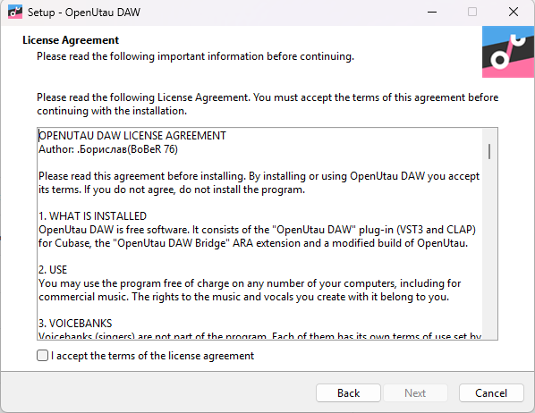
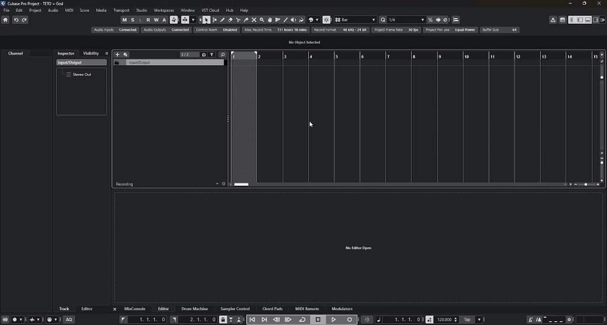
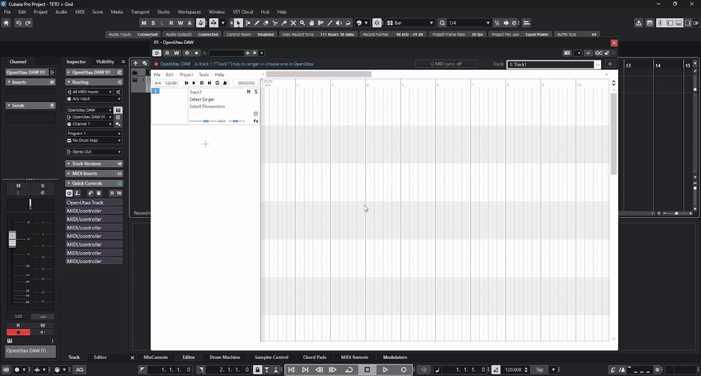
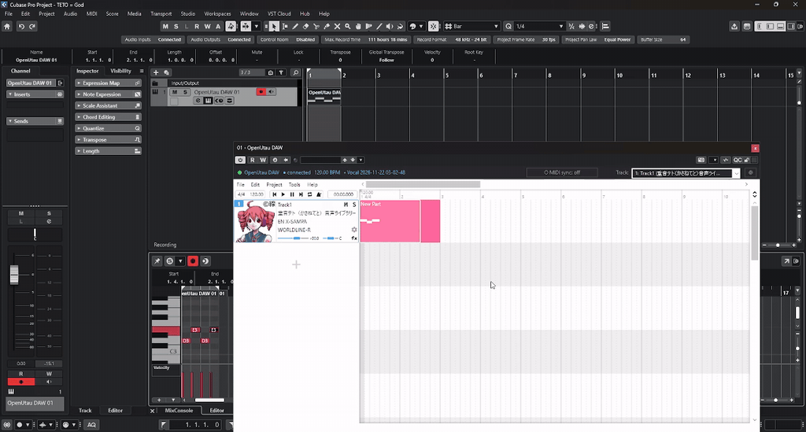
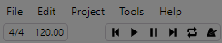
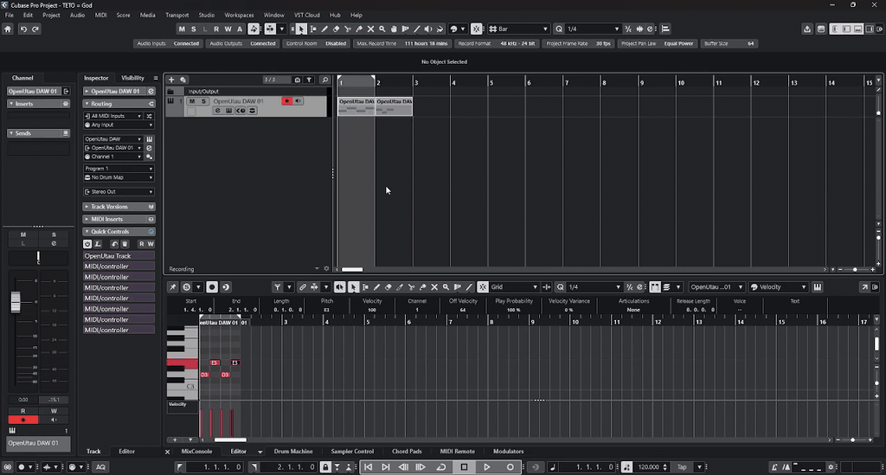
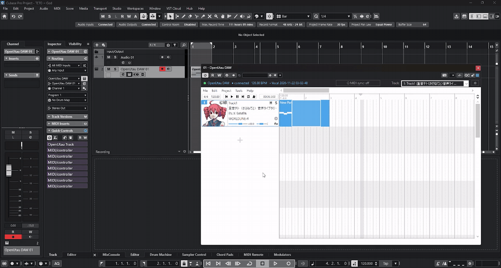
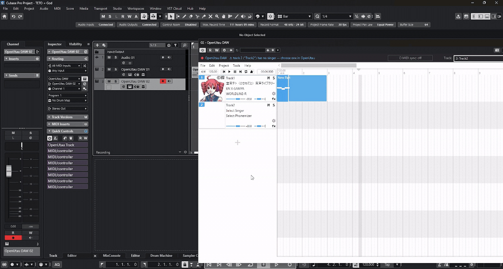
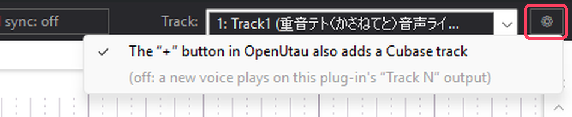

# 📖 OpenUtau DAW Kılavuzu

[← Ana sayfa](README.tr.md)

🌍 [Русский](GUIDE.md) · [English](GUIDE-en.md) · [Українська](GUIDE-uk.md) · [日本語](GUIDE-ja.md) · [Español](GUIDE-es.md) · [Deutsch](GUIDE-de.md) · [Français](GUIDE-fr.md) · [Italiano](GUIDE-it.md) · [Português](GUIDE-pt.md) · [Polski](GUIDE-pl.md) · [Čeština](GUIDE-cs.md) · **Türkçe** · [简体中文](GUIDE-zh.md) · [한국어](GUIDE-ko.md)

> [!NOTE]
> Bu kılavuz makine çevirisiyle hazırlandı: yazar Türkçe bilmiyor. Düzeltmeler [Issues](https://github.com/BoBeR76/OpenUtau-DAW/issues) bölümünde memnuniyetle karşılanır.

OpenUtau DAW, şarkı sentezi düzenleyicisi OpenUtau'yu doğrudan Cubase eklenti penceresine yerleştirir. Burada eklentinin eklediği özellikler anlatılır; OpenUtau'nun kendisi her zamanki gibi çalışır.

## Kurulum

1. `OpenUtauDAW-Setup-2.7.2.exe` dosyasını [Releases](https://github.com/BoBeR76/OpenUtau-DAW/releases/latest) sayfasından indirin.
2. **Cubase'i kapatın.** Açıksa kurulum programı kapatmanızı ve “Yeniden dene”ye basmanızı ister.
3. İlk sayfada dili seçin — bu aynı zamanda OpenUtau'nun ve eklenti çubuğunun dili olur.
4. Lisans sözleşmesinin kutusunu işaretleyin — işaretlemeden “İleri” etkinleşmez.

Kurulanlar: **OpenUtau DAW** eklentisi (VST3 ve CLAP), **OpenUtau DAW Bridge** tempo köprüsü (ARA2) ve `C:\OpenUtau-DAW` içine DAW için OpenUtau.

| | |
|---|---|
|  |  |

> **Güncelleme.** Yeni sürüm eskisinin üzerine kurulur. OpenUtau ayarları, ses bankaları ve projeler korunur.

## İlk başlatma

1. Cubase'de **OpenUtau DAW** eklentili bir **Instrument parçası** ekleyin.
2. **OpenUtau doğrudan eklenti penceresinde açılır** ve bu eklenti için boş bir parça kendiliğinden oluşturulur.
3. Bir şarkıcı seçin ve yazmaya başlayın.

> Eklenti listede yoksa: *Studio → VST Plug-in Manager → yeniden tara*.

## Eklenti çubuğu

Eklenti penceresinde OpenUtau'nun üstündeki şerit:

| Görünen | Anlamı |
|---|---|
| 🟢 **bağlı** | Her şey hazır, ses notalara uygun |
| 🟡 **işleniyor %45** | OpenUtau sesi hazırlıyor |
| 🔴 **⚠ …** | Bir sorun var — ve ne olduğu yazılı, ör. “1. parçanın şarkıcısı yok — OpenUtau'da seçin” |
| **110.00 BPM** | OpenUtau'nun gördüğü Cubase temposu |
| **MIDI eşitleme** | Çalma sırasında notaları Cubase'den alır (aşağıya bakın) |
| **⚙** | Eklenti ayarları |

## Cubase ile OpenUtau arasında notalar

### Sürükle ve bırak

- **Cubase → OpenUtau:** Cubase proje penceresinden bir MIDI parçasını OpenUtau penceresine, istediğiniz parçaya ve ölçüye sürükleyin.
- **OpenUtau → Cubase:** OpenUtau'da bir bölümü tutun, **eklenti penceresinin kenarının dışına** sürükleyin ve bir Cubase parçasının **boş bir yerine** bırakın.

> Cubase bölümü yeni bir parçaya koyarsa: *Edit → Preferences → MIDI → MIDI File* → **“Import Dropped File as Single Part”** seçeneğini açın.

### Çalarken eşitleme

1. “OpenUtau DAW” parçasındaki bir MIDI bölümüne notaları yazın.
2. Eklenti çubuğunda **“MIDI eşitleme”**yi açın ve bölümü çalın.
3. Notalar OpenUtau'da görünür. **Önceden girdiğiniz heceler korunur** — sözleri kaybetmeden melodiyi Cubase'de değiştirebilirsiniz.
4. Bitince “MIDI eşitleme”yi kapatın.

### Tuşlar yanar

Basılan notalar, Cubase düzenleyicisinde olduğu gibi OpenUtau piyano rulosunda görünür:

- **MIDI klavyede** çalarsınız ya da Cubase düzenleyicisindeki tuşlara tıklarsınız — bu tuşlar **OpenUtau'da yanar**;
- OpenUtau piyano rulosunun tuşlarına tıklarsınız — nota eklentinin çıkışında, **Cubase üzerinden** çalar.

## Aktarım ve tempo

- OpenUtau'daki **Çal, Durdur ve “başa dön”** (ve `Boşluk`, `Home`) Cubase'i kontrol eder — yalnızca vokal değil, tüm şarkı çalar.
- OpenUtau **tempoyu ve ölçü birimini** Cubase'den alır: BPM'i değiştirin, OpenUtau uyum sağlar.

## Tempo köprüsü OpenUtau DAW Bridge

**Tempo şarkı boyunca değişiyorsa** köprüyü ekleyin — böylece OpenUtau tüm tempo ve ölçü haritasını bilir. Proje başına bir kez:

1. Bir ses parçası oluşturun ve üzerine tüm şarkıyı kapsayan herhangi bir ses olayı koyun. Sessize alın (Mute).
2. Olayı seçin → *Audio → Extensions →* **“OpenUtau DAW Bridge”**.

Köprü VOCALOID'dekiyle aynı şekilde çalışır.

## Birden fazla ses

**Cubase'deki her “OpenUtau DAW” parçası ayrı bir sestir**, hepsi tek bir OpenUtau penceresinde.

- Cubase'de yeni “OpenUtau DAW” parçası → OpenUtau'da yeni boş parça.
- OpenUtau'da **“+”** → **Cubase'de de** yeni parça.

- Cubase parçasının **adı ve rengi** OpenUtau'ya aktarılır.

### ⚙ “+” Cubase'de parça oluşturmasın istiyorsanız

> [!TIP]
> **Tek bir Cubase parçasında birden fazla ses mi gerekiyor?** Eklenti çubuğunun sağındaki **⚙** simgesine tıklayın ve **“OpenUtau'daki “+” düğmesi Cubase'e de parça ekler”** işaretini kaldırın.
>
> Bu durumda “+” sesi yalnızca OpenUtau'ya ekler ve ses aynı eklentinin **“Track N”** çıkışında çalar (**F11**'de etkinleştirin).

## Kaydetme ve yedekler

- **Vokal, Cubase projesiyle birlikte otomatik olarak kaydedilir.**
- **Son 10 sürüm** saklanır. Birini geri yüklemek için: *Dosya →* **“Yedekten geri yükle”**.

## Küçük kolaylıklar

- 🔁 **Otomatik yeniden başlatma.** OpenUtau çökerse eklenti onu yeniden başlatır. Vokal kaybolmaz.
- 🔔 **Yeni sürümler.** Bir güncelleme çıktığında eklenti çubuğunda indirme sayfasını açan “⬆ Güncelleme” düğmesi görünür. ⚙ menüsünden kapatılabilir.
- 🪟 **Eklentinin üzerinde pencereler.** OpenUtau'nun ayarları, şarkıcıları ve mesajları eklenti penceresinin üzerinde açılır — Cubase onu gizlemez.
- 🎚 **Ayrı çıkışlar.** Her OpenUtau parçası için bir tane olmak üzere 8 stereo çıkış “Track 1…8” (F11'de etkinleştirilir).
- ⏳ **Dışa aktarma işlemeyi bekler.** OpenUtau hâlâ sesi hazırlıyorsa Audio Mixdown bekler.
- ⚡ **Gereksiz pencere yok.** Cubase içinde OpenUtau başlangıç sayfasını atlar ve doğrudan projenin vokalini açar.
- 🌍 **14 dil**, ve eklenti çubuğu OpenUtau ile aynı dili konuşur.

## Henüz mümkün olmayanlar

- **Notaları Cubase'in kendi düzenleyicisinde yazmak** (VOCALOID'deki gibi) ve canlı çift yönlü nota eşitlemesi. Bu, ARA 3'ü bekliyor — Celemony yayımlar yayımlamaz yapılacak.
- Cubase işaretçileri eklentilere açık değildir, bu yüzden OpenUtau onları gösteremez.

## Sık sorulan sorular

**Kurulum programı Cubase'in çalıştığını söylüyor.** Cubase'i tamamen kapatın (pencere kapandıktan sonra işlem birkaç saniye daha sürer) ve “Yeniden dene”ye basın.

**Ses yok.** Eklenti çubuğundaki noktaya bakın: 🔴 — nedeni yanında yazılı; 🟡 — işlemenin bitmesini bekleyin.

**Eklenti listede yok.** *Studio → VST Plug-in Manager → yeniden tara*.

**“OpenUtau başka bir eklenti penceresinde açık”.** Mesaja tıklayın — OpenUtau bu pencereye taşınır.
