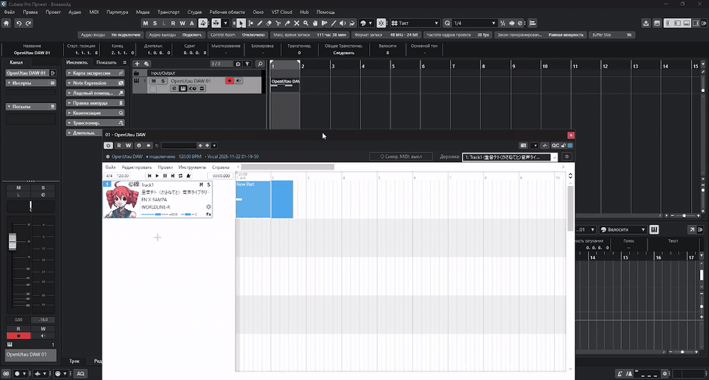

# 📖 Інструкція OpenUtau DAW

[← На головну](../README.md)

🌍 [Русский](GUIDE.md) · [English](GUIDE-en.md) · **Українська** · [日本語](GUIDE-ja.md) · [Español](GUIDE-es.md) · [Deutsch](GUIDE-de.md) · [Français](GUIDE-fr.md) · [Italiano](GUIDE-it.md) · [Português](GUIDE-pt.md) · [Polski](GUIDE-pl.md) · [Čeština](GUIDE-cs.md) · [Türkçe](GUIDE-tr.md) · [简体中文](GUIDE-zh.md) · [한국어](GUIDE-ko.md)

> [!NOTE]
> Цю інструкцію перекладено машинним перекладачем: автор не володіє українською. Якщо щось звучить дивно — виправлення вітаються в [Issues](https://github.com/BoBeR76/OpenUtau-DAW/issues).

OpenUtau DAW вбудовує редактор співу OpenUtau просто у вікно плагіна Cubase. Тут — те, що додає плагін; сам OpenUtau працює як звичайно. *(На анімаціях — російський інтерфейс.)*

## Встановлення

1. Завантажте `OpenUtauDAW-Setup-2.7.1.exe` з [Releases](https://github.com/BoBeR76/OpenUtau-DAW/releases/latest).
2. **Закрийте Cubase.** Якщо вона відкрита, інсталятор попросить її закрити й натиснути «Повторити».
3. На першій сторінці виберіть мову — вона ж стане мовою OpenUtau та панелі плагіна.
4. Поставте галочку ліцензійної угоди — без неї «Далі» не натискається.

Встановлюються плагін **OpenUtau DAW** (VST3 і CLAP), міст темпу **OpenUtau DAW Bridge** (ARA2) та OpenUtau для DAW у `C:\OpenUtau-DAW`.

| | |
|---|---|
|  |  |

> **Оновлення.** Нова версія ставиться поверх старої. Налаштування OpenUtau, голосові банки та проєкти не змінюються.

## Перший запуск

1. Додайте в Cubase **Instrument-доріжку** з плагіном **OpenUtau DAW**.
2. **OpenUtau відкриється просто у вікні плагіна**, і в ньому сама створиться порожня доріжка для цього плагіна.
3. Виберіть співака — і можна писати.

> Якщо плагіна немає в списку: *Studio → VST Plug-in Manager → пересканувати*.

## Панель плагіна

Смужка над OpenUtau у вікні плагіна:

| Що видно | Що означає |
|---|---|
| 🟢 **під'єднано** | Усе готово, звук відповідає нотам |
| 🟡 **рендер 45 %** | OpenUtau готує звук |
| 🔴 **⚠ …** | Щось не так — і написано що, наприклад «у доріжки 1 немає співака — виберіть його в OpenUtau» |
| **110.00 BPM** | Темп Cubase, який бачить OpenUtau |
| **Синхр. MIDI** | Перенесення нот із Cubase під час відтворення (див. нижче) |
| **⚙** | Налаштування плагіна |

## Ноти з Cubase в OpenUtau і назад

### Перетягуванням

- **Cubase → OpenUtau:** перетягніть MIDI-партію з вікна проєкту Cubase у вікно OpenUtau — на потрібну доріжку й такт.
- **OpenUtau → Cubase:** затисніть партію в OpenUtau, витягніть її **за край вікна плагіна** й відпустіть на **порожньому місці** доріжки Cubase.

> Якщо Cubase кладе партію на нову доріжку: *Edit → Preferences → MIDI → MIDI File* → увімкніть **«Import Dropped File as Single Part»**.

### Синхронізація під час відтворення

1. Напишіть ноти в MIDI-партії на доріжці «OpenUtau DAW».
2. Увімкніть **«Синхр. MIDI»** на панелі плагіна й відтворіть потрібну ділянку.
3. Ноти з'являться в OpenUtau. **Склади, які ви вже ввели, зберігаються** — мелодію можна правити в Cubase, не втрачаючи текст.
4. Закінчили — вимкніть «Синхр. MIDI».

### Клавіші підсвічуються

Натиснуті ноти видно в піаноролі OpenUtau — як у редакторі Cubase:

- граєте на **MIDI-клавіатурі** або клацаєте по клавішах у редакторі Cubase — ці клавіші **загоряються в OpenUtau**;
- клацаєте по клавішах піанороли OpenUtau — нота звучить **через Cubase**, на виході плагіна.

## Транспорт і темп

- Кнопки **Play, Stop і «на початок»** в OpenUtau (і `Пробіл`, `Home`) керують Cubase — грає вся пісня, а не лише вокал.
- **Темп і розмір такту** OpenUtau бере з Cubase: змінили BPM — OpenUtau підлаштувався.

## Міст темпу OpenUtau DAW Bridge

Якщо **темп змінюється протягом пісні**, додайте міст — тоді OpenUtau знає всю карту темпу й тактів. Один раз на проєкт:

1. Створіть аудіодоріжку й покладіть на неї будь-яку аудіоподію на всю довжину пісні. Заглушіть її (Mute).
2. Виділіть подію → *Audio → Extensions →* **«OpenUtau DAW Bridge»**.

Міст працює так само, як у VOCALOID.

## Кілька голосів

**Кожна доріжка «OpenUtau DAW» у Cubase — окремий голос**, і всі вони в одному вікні OpenUtau.

- Нова доріжка «OpenUtau DAW» у Cubase → нова порожня доріжка в OpenUtau.
- **«+»** в OpenUtau → нова доріжка **і в Cubase**.

- **Назва й колір** доріжки Cubase переносяться в OpenUtau.

### ⚙ Якщо «+» не має створювати доріжку в Cubase

> [!TIP]
> **Потрібно кілька голосів на одній доріжці Cubase?** Натисніть **⚙** праворуч на панелі плагіна й зніміть галочку **«Кнопка «+» в OpenUtau створює доріжку в Cubase»**.
>
> Тоді «+» додає голос лише в OpenUtau, а звучить він на окремому виході **«Track N»** цього ж плагіна (увімкніть його в **F11**).

## Збереження й резервні копії

- **Вокал зберігається сам разом із проєктом Cubase.**
- Зберігаються **10 останніх копій** вокалу. Повернути одну: *Файл →* **«Відновити з резервної копії»**.

## Дрібниці, які приємно знати

- 🔁 **Автоперезапуск.** Якщо OpenUtau впав, плагін сам його перезапустить. Вокал не втрачається.
- 🪟 **Вікна поверх плагіна.** Налаштування, співаки й повідомлення OpenUtau відкриваються поверх вікна плагіна — Cubase його не ховає.
- 🎚 **Окремі виходи.** 8 стерео-виходів «Track 1…8» — по одному на доріжку OpenUtau (вмикаються в F11).
- ⏳ **Експорт чекає рендер.** Якщо OpenUtau ще готує звук, Audio Mixdown зачекає.
- ⚡ **Без зайвих вікон.** У Cubase OpenUtau не показує стартову сторінку — одразу відкриває вокал проєкту.
- 🌍 **14 мов**, і панель плагіна говорить тією ж мовою, що й OpenUtau.

## Що поки неможливо

- **Писати ноти у вбудованому редакторі Cubase** (як у VOCALOID) і жива двостороння синхронізація нот. Це чекає ARA 3 — щойно Celemony його випустить, буде зроблено.
- Маркери Cubase недоступні плагінам, тому в OpenUtau їх не видно.

## Часті питання

**Інсталятор пише, що Cubase запущена.** Закрийте Cubase повністю (процес закривається за кілька секунд після вікна) і натисніть «Повторити».

**Немає звуку.** Подивіться на крапку на панелі плагіна: 🔴 — поруч написано причину; 🟡 — дочекайтеся кінця рендеру.

**Плагіна немає в списку.** *Studio → VST Plug-in Manager → пересканувати*.

**«OpenUtau відкрито в іншому вікні плагіна».** Клацніть по написові — OpenUtau переїде в це вікно.
