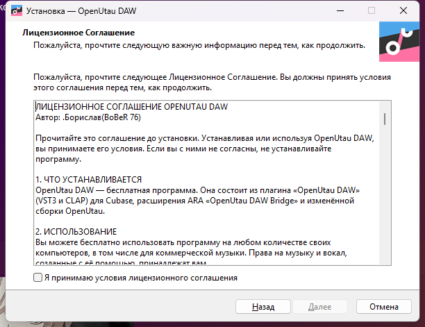
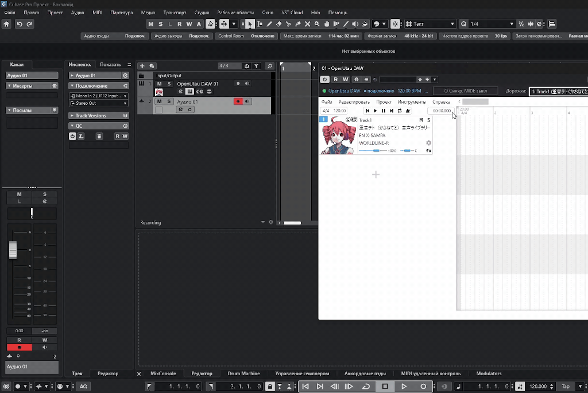

# 📖 OpenUtau DAW 使用说明

[← 首页](../README.md)

🌍 [Русский](GUIDE.md) · [English](GUIDE-en.md) · [Українська](GUIDE-uk.md) · [日本語](GUIDE-ja.md) · [Español](GUIDE-es.md) · [Deutsch](GUIDE-de.md) · [Français](GUIDE-fr.md) · [Italiano](GUIDE-it.md) · [Português](GUIDE-pt.md) · [Polski](GUIDE-pl.md) · [Čeština](GUIDE-cs.md) · [Türkçe](GUIDE-tr.md) · **简体中文** · [한국어](GUIDE-ko.md)

> [!NOTE]
> 本说明由机器翻译完成：作者不懂中文。如有不通顺之处，欢迎在 [Issues](https://github.com/BoBeR76/OpenUtau-DAW/issues) 中指正。

OpenUtau DAW 把歌声合成编辑器 OpenUtau 直接嵌入 Cubase 的插件窗口。这里介绍插件新增的功能；OpenUtau 本身的用法不变。*（动画中显示的是俄语界面。）*

## 安装

1. 从 [Releases](https://github.com/BoBeR76/OpenUtau-DAW/releases/latest) 下载 `OpenUtauDAW-Setup-2.7.0.exe`。
2. **关闭 Cubase。** 如果 Cubase 正在运行，安装程序会提示关闭它并点击“重试”。
3. 在第一页选择语言——它也将是 OpenUtau 和插件栏的语言。
4. 勾选许可协议复选框——不勾选就无法点击“下一步”。

安装内容：插件 **OpenUtau DAW**（VST3 和 CLAP）、速度桥 **OpenUtau DAW Bridge**（ARA2），以及位于 `C:\OpenUtau-DAW` 的 DAW 版 OpenUtau。

| | |
|---|---|
|  |  |

> **更新。** 新版本直接覆盖安装在旧版本上。OpenUtau 的设置、声库和工程都会保留。

## 首次使用

1. 在 Cubase 中添加一条挂载 **OpenUtau DAW** 插件的 **Instrument 音轨**。
2. **OpenUtau 会直接在插件窗口中打开**，并自动为该插件创建一条空音轨。
3. 选择歌手，即可开始编写。

> 如果列表中没有该插件：*Studio → VST Plug-in Manager → 重新扫描*。

## 插件栏

插件窗口中 OpenUtau 上方的横条：

| 显示 | 含义 |
|---|---|
| 🟢 **已连接** | 一切就绪，声音与音符一致 |
| 🟡 **渲染中 45%** | OpenUtau 正在准备声音 |
| 🔴 **⚠ …** | 出现问题，并会写明原因，例如“音轨 1 没有歌手——请在 OpenUtau 中选择” |
| **110.00 BPM** | OpenUtau 获取到的 Cubase 速度 |
| **MIDI 同步** | 播放时从 Cubase 获取音符（见下文） |
| **⚙** | 插件设置 |

## 在 Cubase 与 OpenUtau 之间传递音符

### 拖放

- **Cubase → OpenUtau：** 把 MIDI 片段从 Cubase 工程窗口拖到 OpenUtau 窗口中目标音轨和小节上。
- **OpenUtau → Cubase：** 在 OpenUtau 中按住一个片段，把它**拖出插件窗口边缘**，松开在 Cubase 音轨的**空白处**。

> 如果 Cubase 把片段放到了新音轨上：*Edit → Preferences → MIDI → MIDI File* → 开启 **“Import Dropped File as Single Part”**。

### 播放时同步

1. 在 “OpenUtau DAW” 音轨的 MIDI 片段中写入音符。
2. 在插件栏中开启 **“MIDI 同步”**，播放需要的段落。
3. 音符会出现在 OpenUtau 中。**已输入的歌词会保留**——可以在 Cubase 中修改旋律而不丢失歌词。
4. 完成后关闭 “MIDI 同步”。

### 琴键会亮起

按下的音符会显示在 OpenUtau 的钢琴卷帘上，和 Cubase 编辑器中一样：

- 在 **MIDI 键盘**上演奏，或点击 Cubase 编辑器中的琴键——这些琴键会**在 OpenUtau 中亮起**；
- 点击 OpenUtau 钢琴卷帘上的琴键——音符会**通过 Cubase** 从插件的输出发声。

## 走带与速度

- OpenUtau 中的**播放、停止和“回到开头”**（以及 `空格`、`Home`）会控制 Cubase——播放的是整首歌，而不只是人声。
- OpenUtau 从 Cubase 获取**速度和拍号**：修改 BPM，OpenUtau 随之调整。

## 速度桥 OpenUtau DAW Bridge

如果**歌曲中途变速**，请添加速度桥——这样 OpenUtau 就能获得完整的速度和小节信息。每个工程只需一次：

1. 新建一条音频音轨，在上面放一个覆盖整首歌的任意音频事件，并将其静音（Mute）。
2. 选中该事件 → *Audio → Extensions →* **“OpenUtau DAW Bridge”**。

工作方式与 VOCALOID 相同。

## 多个声部

**Cubase 中的每条 “OpenUtau DAW” 音轨都是一个独立的声部**，它们都在同一个 OpenUtau 窗口中。

- 在 Cubase 中新建 “OpenUtau DAW” 音轨 → OpenUtau 中出现一条新的空音轨。
- 在 OpenUtau 中点击 **“+”** → **Cubase 中也会**新建音轨。

- Cubase 音轨的**名称和颜色**会同步到 OpenUtau。

### ⚙ 如果不希望“+”在 Cubase 中创建音轨

> [!TIP]
> **需要在一条 Cubase 音轨上放多个声部？** 点击插件栏右侧的 **⚙**，取消勾选 **“OpenUtau 中的“+”按钮也会在 Cubase 中添加音轨”**。
>
> 这样“+”只在 OpenUtau 中添加声部，它会从同一插件的 **“Track N”** 输出发声（在 **F11** 中启用）。

## 保存与备份

- **人声会随 Cubase 工程自动保存。**
- 会保留**最近 10 个版本**。恢复其中之一：*文件 →* **“从备份恢复”**。

## 贴心小功能

- 🔁 **自动重启。** OpenUtau 崩溃时，插件会自动重新启动它。人声不会丢失。
- 🪟 **窗口显示在插件之上。** OpenUtau 的设置、歌手和提示窗口都显示在插件窗口之上——Cubase 不会把它隐藏。
- 🎚 **独立输出。** 8 个立体声输出 “Track 1…8”，每条 OpenUtau 音轨一个（在 F11 中启用）。
- ⏳ **导出会等待渲染。** 如果 OpenUtau 仍在准备声音，Audio Mixdown 会等待。
- ⚡ **没有多余窗口。** 在 Cubase 中，OpenUtau 跳过开始页面，直接打开工程的人声。
- 🌍 **14 种语言**，插件栏与 OpenUtau 使用同一种语言。

## 暂时还不能做到的

- **在 Cubase 自带的编辑器中写音符**（像 VOCALOID 那样）以及实时双向音符同步。这需要等待 ARA 3——Celemony 一发布就会实现。
- 插件无法获取 Cubase 的标记，因此 OpenUtau 无法显示它们。

## 常见问题

**安装程序提示 Cubase 正在运行。** 彻底关闭 Cubase（关闭窗口后进程还会持续几秒），然后点击“重试”。

**没有声音。** 查看插件栏上的圆点：🔴——旁边写有原因；🟡——请等待渲染完成。

**列表中没有该插件。** *Studio → VST Plug-in Manager → 重新扫描*。

**提示“OpenUtau 已在另一个插件窗口中打开”。** 点击该提示——OpenUtau 会移到此窗口。
