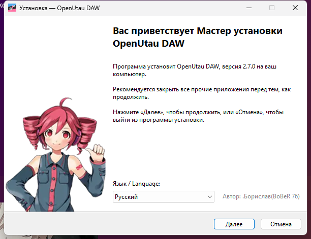

# 📖 Инструкция OpenUtau DAW

[← На главную](../README.md) · [English](GUIDE-en.md) · [Другие языки](#другие-языки)

OpenUtau DAW встраивает редактор пения OpenUtau прямо в окно плагина Cubase. Здесь — то, что добавляет плагин; сам OpenUtau работает как обычно.

## Содержание

- [Установка](#установка)
- [Первый запуск](#первый-запуск)
- [Панель плагина](#панель-плагина)
- [Ноты из Cubase в OpenUtau и обратно](#ноты-из-cubase-в-openutau-и-обратно)
- [Транспорт и темп](#транспорт-и-темп)
- [Мост темпа OpenUtau DAW Bridge](#мост-темпа-openutau-daw-bridge)
- [Несколько голосов](#несколько-голосов)
- [Сохранение и резервные копии](#сохранение-и-резервные-копии)
- [Мелочи, которые приятно знать](#мелочи-которые-приятно-знать)
- [Что пока нельзя](#что-пока-нельзя)
- [Частые вопросы](#частые-вопросы)

---

## Установка

1. Скачайте `OpenUtauDAW-Setup-2.7.0.exe` из [Releases](https://github.com/BoBeR76/OpenUtau-DAW/releases/latest).
2. **Закройте Cubase.** Если она открыта, установщик попросит её закрыть и нажать «Повтор».
3. На первой странице выберите язык — он же станет языком OpenUtau и панели плагина.
4. Отметьте галочку лицензионного соглашения — без неё «Далее» не нажимается.

Ставятся плагин **OpenUtau DAW** (VST3 и CLAP), мост темпа **OpenUtau DAW Bridge** (ARA2) и OpenUtau для DAW в `C:\OpenUtau-DAW`.

| | |
|---|---|
|  |  |

> **Обновление.** Новая версия ставится поверх старой — удалять ничего не нужно. Настройки OpenUtau, голосовые банки и проекты не трогаются.

## Первый запуск

1. В Cubase добавьте **Instrument-дорожку** с плагином **OpenUtau DAW**.
2. **OpenUtau откроется прямо в окне плагина**, и в нём сама создастся пустая дорожка для этого плагина.
3. Выберите певца — и можно писать.

> Если плагина нет в списке: *Студия → VST Plug-in Manager → «Пересканировать»*.

## Панель плагина

Полоска над OpenUtau в окне плагина:

| Что видно | Что значит |
|---|---|
| 🟢 **подключено** | Всё готово, звук соответствует нотам |
| 🟡 **рендер 45 %** | OpenUtau готовит звук |
| 🔴 **⚠ …** | Что-то не так — и написано что, например «у дорожки 1 нет певца — выберите его в OpenUtau» |
| **110.00 BPM** | Темп Cubase, который видит OpenUtau |
| **Синхр. MIDI** | Перенос нот из Cubase при проигрывании ([ниже](#синхронизация-при-проигрывании)) |
| **⚙** | Настройки плагина |

## Ноты из Cubase в OpenUtau и обратно

### Перетаскиванием

- **Cubase → OpenUtau:** перетащите MIDI-партию из окна проекта Cubase в окно OpenUtau — на нужную дорожку и такт.
- **OpenUtau → Cubase:** зажмите часть в OpenUtau, вытяните её **за край окна плагина** и отпустите на **пустом месте** дорожки Cubase.

> Если Cubase кладёт партию на новую дорожку: *Правка → Preferences → MIDI-файл* → включите **«Импортировать перетаскиваемый MIDI-файл как одну партию»**.

### Синхронизация при проигрывании

1. Нарисуйте ноты в MIDI-партии на дорожке «OpenUtau DAW».
2. Включите **«Синхр. MIDI»** на панели плагина и проиграйте нужный участок.
3. Ноты появятся в OpenUtau. **Слоги, которые вы уже ввели, сохраняются** — можно править мелодию в Cubase, не теряя текст.
4. Закончили — выключите «Синхр. MIDI».

### Клавиши подсвечиваются

Нажатые ноты видны в пианоролле OpenUtau — как в редакторе Cubase:

- играете на **MIDI-клавиатуре** или щёлкаете по клавишам в редакторе Cubase — эти клавиши **загораются в OpenUtau**;
- щёлкаете по клавишам пианоролла OpenUtau — нота звучит **через Cubase**, на выходе плагина.

## Транспорт и темп

- Кнопки **Play, Stop и «в начало»** в OpenUtau (и `Пробел`, `Home`) управляют Cubase — играет вся песня, а не только вокал.
- **Темп и размер такта** OpenUtau берёт из Cubase: поменяли BPM — OpenUtau подстроился.

## Мост темпа OpenUtau DAW Bridge

Если **темп меняется по ходу песни**, добавьте мост — тогда OpenUtau знает всю карту темпа и тактов. Один раз на проект:

1. Создайте аудиодорожку и положите на неё любое аудиособытие на всю длину песни. Заглушите его (Mute).
2. Выделите событие → *Audio → Extensions →* **«OpenUtau DAW Bridge»**.

Мост работает так же, как у VOCALOID.

## Несколько голосов

**Каждая дорожка «OpenUtau DAW» в Cubase — свой голос**, и все они в одном окне OpenUtau.

- Новая дорожка «OpenUtau DAW» в Cubase → новая пустая дорожка в OpenUtau.
- **«+»** в OpenUtau → новая дорожка **и в Cubase**.

- **Имя и цвет** дорожки Cubase переносятся в OpenUtau.

### ⚙ Если «+» не должен создавать дорожку в Cubase

> [!TIP]
> **Нужно несколько голосов на одной дорожке Cubase?** Нажмите **⚙** справа на панели плагина и снимите галочку **«Кнопка «+» в OpenUtau создаёт дорожку в Cubase»**.
>
> Тогда «+» в OpenUtau добавляет голос только в OpenUtau, а звучит он на отдельном выходе **«Track N»** этого же плагина (включите его в **F11**). Удобно, если не хотите плодить дорожки в проекте или сводите голоса через выходы.

## Сохранение и резервные копии

- **Вокал сохраняется сам вместе с проектом Cubase.**
- Хранятся **10 последних копий** вокала. Вернуть одну: *Файл →* **«Восстановить из резервной копии»**.

## Мелочи, которые приятно знать

- 🔁 **Автоперезапуск.** Если OpenUtau упал, плагин сам его перезапустит. Вокал не теряется.
- 🪟 **Окна поверх плагина.** Параметры, певцы и сообщения OpenUtau открываются поверх окна плагина — Cubase его не прячет.
- 🎚 **Отдельные выходы.** 8 стерео-выходов «Track 1…8» — по одному на дорожку OpenUtau (включаются в F11).
- ⏳ **Экспорт ждёт рендер.** Если OpenUtau ещё готовит звук, Audio Mixdown подождёт.
- ⚡ **Без лишних окон.** В Cubase OpenUtau не показывает стартовую страницу — сразу открывает вокал проекта.
- 🌍 **14 языков**, и панель плагина говорит на том же языке, что и OpenUtau.

## Что пока нельзя

- **Писать ноты во встроенном редакторе Cubase** (как у VOCALOID) и живая двусторонняя синхронизация нот. Это ждёт ARA 3 — как только Celemony его выпустит, будет сделано.
- Маркеры Cubase недоступны плагинам, поэтому в OpenUtau их не видно.

## Частые вопросы

**Установщик пишет, что Cubase запущен.** Закройте Cubase полностью (процесс закрывается несколько секунд после окна) и нажмите «Повтор».

**Нет звука.** Посмотрите на точку на панели плагина: 🔴 — рядом написана причина; 🟡 — подождите конца рендера.

**Плагина нет в списке.** *Студия → VST Plug-in Manager → «Пересканировать»*.

**«OpenUtau открыт в другом окне плагина».** Щёлкните по надписи — OpenUtau переедет в это окно.

---

## Другие языки

Краткая инструкция на всех 14 языках (такая же ставится с программой):

[Русский](guides/guide-ru.txt) ·
[English](guides/guide-en.txt) ·
[Українська](guides/guide-uk.txt) ·
[日本語](guides/guide-ja.txt) ·
[Español](guides/guide-es.txt) ·
[Deutsch](guides/guide-de.txt) ·
[Français](guides/guide-fr.txt) ·
[Italiano](guides/guide-it.txt) ·
[Português](guides/guide-pt.txt) ·
[Polski](guides/guide-pl.txt) ·
[Čeština](guides/guide-cs.txt) ·
[Türkçe](guides/guide-tr.txt) ·
[简体中文](guides/guide-zh.txt) ·
[한국어](guides/guide-ko.txt)
