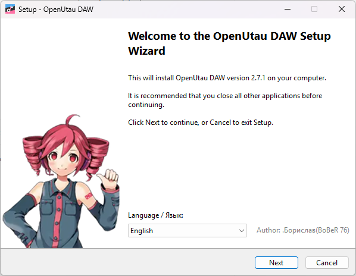

# OpenUtau DAW

**OpenUtau dentro de Cubase — como VOCALOID, pero gratis**

[**⬇ Descargar el instalador**](https://github.com/BoBeR76/OpenUtau-DAW/releases/latest) · [**📖 Guía**](GUIDE-es.md)

🌍 [English](../README.md) · [Русский](README.ru.md) · [Українська](README.uk.md) · [日本語](README.ja.md) · **Español** · [Deutsch](README.de.md) · [Français](README.fr.md) · [Italiano](README.it.md) · [Português](README.pt.md) · [Polski](README.pl.md) · [Čeština](README.cs.md) · [Türkçe](README.tr.md) · [简体中文](README.zh.md) · [한국어](README.ko.md)

> [!NOTE]
> Esta página se tradujo con un traductor automático: el autor no habla español. Las correcciones son bienvenidas en [Issues](https://github.com/BoBeR76/OpenUtau-DAW/issues).

## Qué es

OpenUtau DAW es un plugin para Cubase que abre el editor de canto [OpenUtau](https://github.com/stakira/OpenUtau) directamente en la ventana del plugin. La voz se escribe y suena dentro del proyecto de Cubase, sin exportar archivos WAV de un lado a otro.

- 🎤 **OpenUtau en la ventana del plugin.** Añada una pista de instrumento y el editor ya está ahí.
- ⏱ **Tempo y compás desde Cubase.** OpenUtau se adapta solo al proyecto. Para cambios de tempo durante la canción existe la extensión ARA **OpenUtau DAW Bridge**.
- ▶ **Transporte compartido.** Reproducir, Detener e «Ir al inicio» en OpenUtau controlan Cubase.
- 🎹 **Notas en ambos sentidos.** Arrastre una parte MIDI de Cubase a OpenUtau y una parte de OpenUtau a una pista de Cubase. Las notas tocadas en un teclado MIDI se iluminan en OpenUtau.
- 👥 **Varias voces.** Cada pista «OpenUtau DAW» es una voz propia; «+» en OpenUtau también añade una pista en Cubase. 8 salidas separadas.
- 💾 **Todo se guarda con el proyecto de Cubase,** además de 10 copias de seguridad de la voz.
- 🌍 **14 idiomas:** русский, English, українська, 日本語, español, Deutsch, français, italiano, português, polski, čeština, Türkçe, 简体中文, 한국어.

| | |
|---|---|
|  |  |
| El plugin en una pista de instrumento | Las ventanas de OpenUtau se abren sobre el plugin |
|  |  |
| Guía integrada | Instalador con elección de idioma |

## Instalación

1. Descargue `OpenUtauDAW-Setup-2.7.2.exe` (o el zip que lo contiene) desde [**Releases**](https://github.com/BoBeR76/OpenUtau-DAW/releases/latest).
2. **Cierre Cubase**: si no, el archivo del plugin estará en uso.
3. Ejecute el instalador, elija el idioma y acepte el acuerdo de licencia.
4. Abra Cubase y añada una pista de instrumento con el plugin **OpenUtau DAW**.

Si el plugin no aparece en la lista: *Studio → VST Plug-in Manager → volver a escanear*.
La nueva versión se instala sobre la anterior; los ajustes de OpenUtau, los bancos de voz y los proyectos se conservan.

**Requisitos:** Windows 10/11 de 64 bits, Cubase 15 (probado). Plugin en formatos VST3 y CLAP; el puente de tempo es ARA2.

## Inicio rápido

1. Elija un cantante en la cabecera de la pista de OpenUtau. Arrastre los bancos de voz (.zip) a la ventana de OpenUtau.
2. Escriba notas y letra en OpenUtau: el sonido sale por la pista de Cubase.
3. Antes de exportar, espere al **punto verde** en la barra del plugin.

**[📖 Guía completa](GUIDE-es.md)**, con imágenes, en 14 idiomas. También se instala con el programa y se abre en OpenUtau: *Ayuda → «Guía de OpenUtau DAW»*.

## Comprobar los archivos

Las sumas SHA-256 están en `SHA256SUMS.txt` de cada versión.

## Licencia y agradecimientos

OpenUtau DAW es gratuito. Las condiciones están en el acuerdo de licencia que muestra el instalador (y en `LICENSE.txt` en la carpeta del programa).

El proyecto se basa en el gran trabajo de otras personas:

- [OpenUtau](https://github.com/stakira/OpenUtau) — stakira y colaboradores (MIT)
- [openutau-vst-bridge](https://github.com/KakaruHayate/openutau-vst-bridge) — KakaruHayate y colaboradores (MPL-2.0), la base del plugin
- VST 3 SDK — Steinberg (MIT), [CLAP](https://github.com/free-audio/clap), [clap-wrapper](https://github.com/free-audio/clap-wrapper) (MIT), ARA SDK — Celemony (Apache 2.0)

El código fuente de las partes bajo MPL-2.0 se instala con el programa en la carpeta `source`. Los textos completos de las licencias están en `THIRD-PARTY-NOTICES.txt`.

OpenUtau DAW no está afiliado a Steinberg, Yamaha, Celemony ni a los autores de OpenUtau. Cubase y VST son marcas de Steinberg Media Technologies GmbH; ARA, de Celemony Software GmbH. Los bancos de voz los distribuyen sus autores bajo sus propias condiciones.

.Борислав(BoBeR 76)

