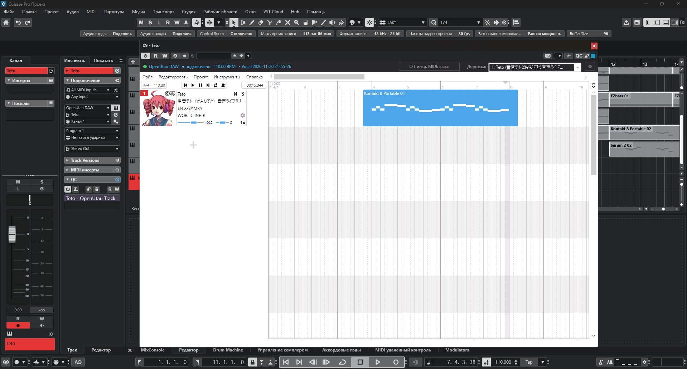

# OpenUtau DAW

**OpenUtau dentro do Cubase — como o VOCALOID, só que grátis**

[**⬇ Baixar o instalador**](https://github.com/BoBeR76/OpenUtau-DAW/releases/latest) · [**📖 Guia**](GUIDE-pt.md)

🌍 [English](../README.md) · [Русский](README.ru.md) · [Українська](README.uk.md) · [日本語](README.ja.md) · [Español](README.es.md) · [Deutsch](README.de.md) · [Français](README.fr.md) · [Italiano](README.it.md) · **Português** · [Polski](README.pl.md) · [Čeština](README.cs.md) · [Türkçe](README.tr.md) · [简体中文](README.zh.md) · [한국어](README.ko.md)

> [!NOTE]
> Esta página foi traduzida com um tradutor automático: o autor não fala português. Correções são bem-vindas em [Issues](https://github.com/BoBeR76/OpenUtau-DAW/issues).

## O que é

O OpenUtau DAW é um plugin para o Cubase que abre o editor de canto [OpenUtau](https://github.com/stakira/OpenUtau) direto na janela do plugin. A voz é escrita e toca dentro do projeto do Cubase, sem exportar arquivos WAV para lá e para cá.

- 🎤 **OpenUtau na janela do plugin.** Adicione uma faixa de instrumento — o editor já está lá.
- ⏱ **Andamento e compasso do Cubase.** O OpenUtau se ajusta sozinho ao projeto. Para mudanças de andamento durante a música existe a extensão ARA **OpenUtau DAW Bridge**.
- ▶ **Transporte compartilhado.** Reproduzir, Parar e “ir para o início” no OpenUtau controlam o Cubase.
- 🎹 **Notas nos dois sentidos.** Arraste uma parte MIDI do Cubase para o OpenUtau e uma parte do OpenUtau para uma faixa do Cubase. Notas tocadas num teclado MIDI acendem no OpenUtau.
- 👥 **Várias vozes.** Cada faixa “OpenUtau DAW” é uma voz própria; o “+” no OpenUtau também adiciona uma faixa no Cubase. 8 saídas separadas.
- 💾 **Tudo é salvo com o projeto do Cubase,** além de 10 backups da voz.
- 🌍 **14 idiomas:** русский, English, українська, 日本語, español, Deutsch, français, italiano, português, polski, čeština, Türkçe, 简体中文, 한국어.

| | |
|---|---|
|  |  |
| O plugin numa faixa de instrumento | As janelas do OpenUtau abrem sobre o plugin |
|  |  |
| Guia integrado | Instalador com escolha de idioma |

## Instalação

1. Baixe `OpenUtauDAW-Setup-2.7.1.exe` (ou o zip com ele) em [**Releases**](https://github.com/BoBeR76/OpenUtau-DAW/releases/latest).
2. **Feche o Cubase** — senão o arquivo do plugin fica em uso.
3. Execute o instalador, escolha o idioma e aceite o contrato de licença.
4. Abra o Cubase e adicione uma faixa de instrumento com o plugin **OpenUtau DAW**.

Se o plugin não estiver na lista: *Studio → VST Plug-in Manager → escanear de novo*.
A nova versão é instalada por cima da antiga; configurações do OpenUtau, voicebanks e projetos são mantidos.

**Requisitos:** Windows 10/11 64 bits, Cubase 15 (testado). Plugin nos formatos VST3 e CLAP; a ponte de andamento é ARA2.

## Início rápido

1. Escolha um cantor no cabeçalho da faixa do OpenUtau. Basta arrastar os voicebanks (.zip) para a janela do OpenUtau.
2. Escreva notas e letra no OpenUtau — o som sai pela faixa do Cubase.
3. Antes de exportar, espere o **ponto verde** na barra do plugin.

**[📖 Guia completo](GUIDE-pt.md)** — com imagens, em 14 idiomas. Ele também é instalado com o programa e abre no OpenUtau: *Ajuda → “Guia do OpenUtau DAW”*.

## Verificação dos arquivos

Os checksums SHA-256 estão em `SHA256SUMS.txt` de cada versão.

## Licença e créditos

O OpenUtau DAW é gratuito. As condições estão no contrato de licença mostrado pelo instalador (e em `LICENSE.txt` na pasta do programa).

O projeto se apoia no ótimo trabalho de outras pessoas:

- [OpenUtau](https://github.com/stakira/OpenUtau) — stakira e colaboradores (MIT)
- [openutau-vst-bridge](https://github.com/KakaruHayate/openutau-vst-bridge) — KakaruHayate e colaboradores (MPL-2.0), a base do plugin
- VST 3 SDK — Steinberg (MIT), [CLAP](https://github.com/free-audio/clap), [clap-wrapper](https://github.com/free-audio/clap-wrapper) (MIT), ARA SDK — Celemony (Apache 2.0)

O código-fonte das partes sob MPL-2.0 é instalado com o programa na pasta `source`. Os textos completos das licenças estão em `THIRD-PARTY-NOTICES.txt`.

O OpenUtau DAW não tem vínculo com a Steinberg, a Yamaha, a Celemony nem com os autores do OpenUtau. Cubase e VST são marcas da Steinberg Media Technologies GmbH; ARA, da Celemony Software GmbH. Os voicebanks são distribuídos por seus autores nos termos deles.

.Борислав(BoBeR 76)

