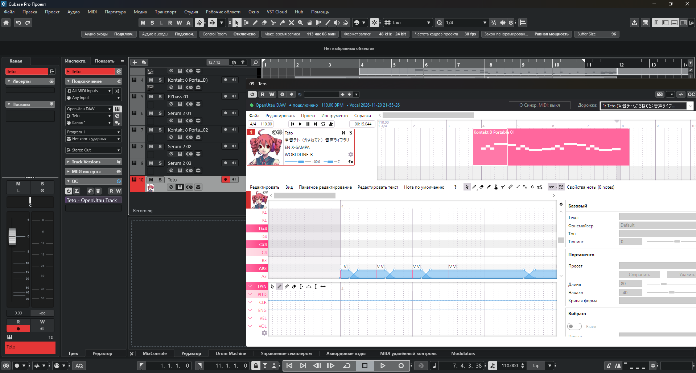

# OpenUtau DAW

**OpenUtau просто всередині Cubase — як VOCALOID, тільки безкоштовно**

[**⬇ Завантажити інсталятор**](https://github.com/BoBeR76/OpenUtau-DAW/releases/latest) · [**📖 Інструкція**](GUIDE-uk.md)

🌍 [English](../README.md) · [Русский](README.ru.md) · **Українська** · [日本語](README.ja.md) · [Español](README.es.md) · [Deutsch](README.de.md) · [Français](README.fr.md) · [Italiano](README.it.md) · [Português](README.pt.md) · [Polski](README.pl.md) · [Čeština](README.cs.md) · [Türkçe](README.tr.md) · [简体中文](README.zh.md) · [한국어](README.ko.md)

> [!NOTE]
> Цю сторінку перекладено машинним перекладачем: автор не володіє українською. Виправлення вітаються в [Issues](https://github.com/BoBeR76/OpenUtau-DAW/issues).

## Що це

OpenUtau DAW — плагін для Cubase, який відкриває редактор співу [OpenUtau](https://github.com/stakira/OpenUtau) просто у вікні плагіна. Вокал пишеться й звучить усередині проєкту Cubase, без експорту WAV туди й назад.

- 🎤 **OpenUtau у вікні плагіна.** Додали Instrument-доріжку — і редактор уже там.
- ⏱ **Темп і розмір із Cubase.** OpenUtau сам підлаштовується під проєкт. Для зміни темпу протягом пісні є ARA-міст **OpenUtau DAW Bridge**.
- ▶ **Спільний транспорт.** Play, Stop і «на початок» в OpenUtau керують Cubase.
- 🎹 **Ноти туди й назад.** MIDI-партію з Cubase можна перетягнути в OpenUtau, а партію з OpenUtau — на доріжку Cubase. Натиснуті на MIDI-клавіатурі ноти підсвічуються в OpenUtau.
- 👥 **Кілька голосів.** Кожна доріжка «OpenUtau DAW» — окремий голос; «+» в OpenUtau додає доріжку й у Cubase. Є 8 окремих виходів.
- 💾 **Усе зберігається з проєктом Cubase,** плюс 10 резервних копій вокалу.
- 🌍 **14 мов:** русский, English, українська, 日本語, español, Deutsch, français, italiano, português, polski, čeština, Türkçe, 简体中文, 한국어.

| | |
|---|---|
|  |  |
| Плагін на Instrument-доріжці | Вікна OpenUtau відкриваються поверх плагіна |
|  |  |
| Вбудована інструкція | Інсталятор із вибором мови |

## Встановлення

1. Завантажте `OpenUtauDAW-Setup-2.7.1.exe` (або zip-архів із ним) з розділу [**Releases**](https://github.com/BoBeR76/OpenUtau-DAW/releases/latest).
2. **Закрийте Cubase** — інакше файл плагіна буде зайнятий.
3. Запустіть інсталятор, виберіть мову, прийміть ліцензійну угоду.
4. Відкрийте Cubase і додайте Instrument-доріжку з плагіном **OpenUtau DAW**.

Якщо плагіна немає в списку: *Studio → VST Plug-in Manager → пересканувати*.
Нова версія ставиться поверх старої; налаштування OpenUtau, голосові банки та проєкти не змінюються.

**Вимоги:** Windows 10/11 64-bit, Cubase 15 (перевірено). Плагін у форматах VST3 і CLAP; міст темпу — ARA2.

## Швидкий старт

1. Виберіть співака в заголовку доріжки OpenUtau. Голосові банки (.zip) просто перетягніть у вікно OpenUtau.
2. Пишіть ноти й текст в OpenUtau — звук іде через доріжку Cubase.
3. Перед експортом дочекайтеся **зеленої крапки** на панелі плагіна.

**[📖 Повна інструкція](GUIDE-uk.md)** — з картинками, 14 мовами. Вона ж встановлюється разом із програмою й відкривається в OpenUtau: *Довідка → «Інструкція OpenUtau DAW»*.

## Перевірка файлів

Контрольні суми SHA-256 — у файлі `SHA256SUMS.txt` кожного релізу.

## Ліцензія й подяки

OpenUtau DAW безкоштовний. Умови — у ліцензійній угоді, яку показує інсталятор (і `LICENSE.txt` у теці програми).

Проєкт побудовано на чудовій роботі інших людей:

- [OpenUtau](https://github.com/stakira/OpenUtau) — stakira й учасники (MIT)
- [openutau-vst-bridge](https://github.com/KakaruHayate/openutau-vst-bridge) — KakaruHayate й учасники (MPL-2.0), основа плагіна
- VST 3 SDK — Steinberg (MIT), [CLAP](https://github.com/free-audio/clap), [clap-wrapper](https://github.com/free-audio/clap-wrapper) (MIT), ARA SDK — Celemony (Apache 2.0)

Вихідний код частин під MPL-2.0 встановлюється разом із програмою в теку `source`. Повні тексти ліцензій — у `THIRD-PARTY-NOTICES.txt`.

OpenUtau DAW не пов'язаний зі Steinberg, Yamaha, Celemony чи авторами OpenUtau. Cubase і VST — торговельні марки Steinberg Media Technologies GmbH, ARA — Celemony Software GmbH. Голосові банки поширюються їхніми авторами на їхніх умовах.

.Борислав(BoBeR 76)

